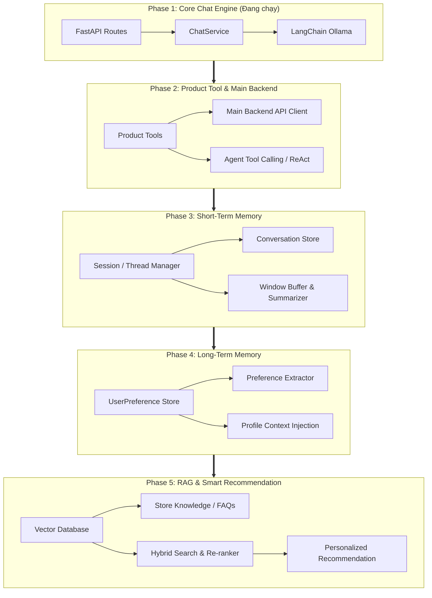

# Customer Shop Assistant - Development Roadmap & Agent Guidelines

Tài liệu này định hình lộ trình phát triển (Roadmap) từng giai đoạn, kiến trúc mục tiêu và các quy chuẩn kỹ thuật cho hệ thống **Customer Shop Assistant**.

---

## 🗺️ Tổng quan Lộ trình (Roadmap Overview)

---

## 📌 Chi tiết từng giai đoạn

### 🟢 Phase 1: Core Chat Engine & Ollama Integration
*Xây dựng nền tảng API, kết nối mô hình ngôn ngữ cục bộ và luồng phản hồi cơ bản.*

- **Trạng thái**: Hoàn thành cơ bản (Completed / Baseline)
- **Mục tiêu**:
  - Khởi tạo backend service bằng **FastAPI** và quản lý phụ thuộc bằng **uv**.
  - Tích hợp **LangChain Ollama** (`ChatOllama`) với hỗ trợ mô hình cục bộ (mặc định: `qwen3.5:4b`).
  - Cung cấp endpoint chat dạng đồng bộ (`/api/v1/chat`) và streaming token (`/api/v1/chat/stream`).
- **Nhiệm vụ chi tiết**:
  - [x] Thiết lập khung dự án, cấu hình môi trường `.env` qua `pydantic-settings`.
  - [x] Triển khai router `/api/v1/health`, `/api/v1/chat`, `/api/v1/chat/stream`.
  - [x] Xây dựng `ChatService` với system prompt định hình phong cách trợ lý bán hàng.
  - [ ] Bổ sung cơ chế xử lý lỗi khi Ollama chưa chạy hoặc model chưa tải (Graceful degraded error handling).
  - [ ] Bổ sung bộ kiểm thử tự động (Unit test / Integration test với `pytest`).

---

### 🟡 Phase 2: Product Tool & Main Backend API Integration
*Nâng cấp chatbot thành Agent có khả năng tra cứu dữ liệu sản phẩm thực tế qua Tool Calling.*

- **Trạng thái**: Tiếp theo (Next Up / Priority)
- **Mục tiêu**:
  - Tích hợp khả năng **Tool Calling / Function Calling** cho Ollama models.
  - Kết nối với **Main Backend API** (hệ thống E-commerce chính hoặc Mock API) để tra cứu dữ liệu thời gian thực.
- **Nhiệm vụ chi tiết**:
  - [ ] Xây dựng HTTP Client (`httpx` async) giao tiếp với Main Backend API:
    - Tìm kiếm sản phẩm theo từ khóa, danh mục, khoảng giá (`search_products`).
    - Lấy thông tin chi tiết sản phẩm, biến thể, hình ảnh (`get_product_detail`).
    - Kiểm tra số lượng tồn kho và chương trình khuyến mãi hiện có (`check_inventory_and_promo`).
  - [ ] Định nghĩa Pydantic Schemas và LangChain Tools cho từng thao tác trên.
  - [ ] Chuyển đổi luồng xử lý từ LLM đơn thuần sang Agent Loop (LangGraph hoặc LangChain Tool-Calling Agent).
  - [ ] Thiết lập prompt hướng dẫn agent biết khi nào cần gọi tool và khi nào trả lời tự nhiên.
  - [ ] Xử lý fallback khi gọi API backend thất bại hoặc phản hồi rỗng.

---

### 🔵 Phase 3: Short-Term Memory & Session/Thread Management
*Lưu trữ và quản trị ngữ cảnh hội thoại đa lượt theo phiên làm việc.*

- **Trạng thái**: Lên kế hoạch (Planned)
- **Mục tiêu**:
  - Frontend không cần gửi toàn bộ mảng `history` trong mỗi request.
  - Lưu và quản lý lịch sử hội thoại tự động dựa trên `session_id` hoặc `thread_id`.
  - Quản trị độ dài ngữ cảnh phù hợp với giới hạn context window của các model cục bộ.
- **Nhiệm vụ chi tiết**:
  - [ ] Thiết kế cơ chế lưu trữ lịch sử (`ConversationStore`):
    - Hỗ trợ InMemory/SQLite cho môi trường local/dev.
    - Hỗ trợ Redis/Database cho môi trường mở rộng (production).
  - [ ] Triển khai cơ chế Sliding Window Buffer:
    - Giữ lại $N$ tin nhắn gần nhất.
    - Tự động tóm tắt (Conversation Summary) các tin nhắn cũ hơn để tiết kiệm token và duy trì thông tin cốt lõi.
  - [ ] Cập nhật endpoint `/api/v1/chat`:
    - Tiếp nhận `session_id` từ client; tự động khôi phục ngữ cảnh hội thoại.
  - [ ] Bổ sung API quản lý phiên:
    - `GET /api/v1/sessions/{session_id}/messages` (lấy lịch sử).
    - `DELETE /api/v1/sessions/{session_id}` (làm mới phiên hội thoại).

---

### 🟣 Phase 4: Long-Term Memory & UserPreference Profiling
*Ghi nhớ sở thích, thói quen và thông tin cá nhân hóa của khách hàng qua nhiều phiên trò chuyện.*

- **Trạng thái**: Lên kế hoạch (Planned)
- **Mục tiêu**:
  - Trợ lý tự động nhận diện và tích lũy thông tin hồ sơ người dùng (`UserPreference`) qua từng lượt trò chuyện.
  - Tự động tiêm (inject) sở thích vào ngữ cảnh để đưa ra tư vấn hợp gu người dùng.
- **Nhiệm vụ chi tiết**:
  - [ ] Thiết kế cấu trúc dữ liệu hồ sơ sở thích (`UserPreference` schema):
    - Khoảng ngân sách quan tâm (ví dụ: bình dân, cao cấp, 500k-1tr).
    - Nhãn hàng / Thương hiệu yêu thích hoặc kiêng kỵ.
    - Kích cỡ (size quần áo, giày dép, nhu cầu kỹ thuật).
    - Các đặc tính riêng (dị ứng, tone màu ưu tiên, mục đích mua sắm).
  - [ ] Xây dựng tác vụ nền phân tích trích xuất thông tin (Background Preference Extractor):
    - Sau khi kết thúc lượt trò chuyện, phân tích tin nhắn để cập nhật hồ sơ khách hàng.
  - [ ] Tích hợp hồ sơ người dùng vào Prompt Template của Agent khi phiên mới bắt đầu.
  - [ ] Bổ sung API cho phép người dùng xem và quản lý/xóa dữ liệu sở thích của chính mình.

---

### 🔴 Phase 5: RAG & Intelligent Recommendation Engine
*Tích hợp kho tri thức cửa hàng và hệ thống gợi ý sản phẩm thông minh.*

- **Trạng thái**: Tương lai (Future)
- **Mục tiêu**:
  - Tìm kiếm và giải đáp dựa trên tài liệu thực tế của cửa hàng: Chính sách bảo hành, đổi trả, cẩm nang chọn đồ, hướng dẫn sử dụng.
  - Đề xuất sản phẩm thông minh dựa trên kết hợp: Nhu cầu người dùng + UserPreference (Phase 4) + Dữ liệu RAG + Tồn kho thực tế (Phase 2).
- **Nhiệm vụ chi tiết**:
  - [ ] Thiết lập Vector Store (ChromaDB / Qdrant / pgvector) và quy trình Ingestion.
  - [ ] Tích hợp mô hình sinh vector nhúng (Embedding) tương thích tốt với tiếng Việt (ví dụ: `bge-m3`, `nomic-embed-text`).
  - [ ] Xây dựng Hybrid Search (kết hợp Semantic Search và Keyword/BM25 Search) kèm Re-ranking.
  - [ ] Tạo module Smart Recommendation:
    - Thuật toán xếp hạng sản phẩm phù hợp nhất với nhu cầu và hồ sơ khách hàng.
    - Tạo câu trả lời thuyết phục kèm dẫn chứng lý do gợi ý sản phẩm.

---

## 🛠️ Quy chuẩn phát triển dành cho Agents (Agent Guidelines)

Khi thực hiện viết mã hoặc mở rộng tính năng trong repository này, các Agents cần tuân thủ các quy tắc sau:

1. **Môi trường & Hệ điều hành**:
   - Hệ điều hành máy chủ phát triển là **Windows**.
   - Luôn sử dụng lệnh PowerShell hoặc Windows CMD tương thích; không dùng lệnh Linux trực tiếp (trừ khi chạy trong WSL/Docker).
   - Nếu sử dụng docker-compose, luôn sử dụng cú pháp `docker-compose` (có gạch nối).

2. **Quản lý gói & Công cụ**:
   - Sử dụng **uv** làm trình quản lý môi trường và gói thư viện duy nhất (`uv sync`, `uv run ...`, `uv add ...`).
   - Python phiên bản `>= 3.14`.

3. **Cấu trúc mã nguồn (Architecture Convention)**:
   - `src/customer_shop_assistant/api/`: Định nghĩa router, request/response DTO schemas (Pydantic).
   - `src/customer_shop_assistant/core/`: Cấu hình hệ thống, logging, hằng số chung.
   - `src/customer_shop_assistant/services/`: Nghiệp vụ trung tâm, tương tác LLM, Agent logic.
   - `src/customer_shop_assistant/tools/` *(dự kiến Phase 2)*: Các công cụ (tools) mà agent có thể thực thi.
   - `src/customer_shop_assistant/memory/` *(dự kiến Phase 3 & 4)*: Xử lý session, context window và user preference.
   - `src/customer_shop_assistant/rag/` *(dự kiến Phase 5)*: Vector store, retriever và embedding logic.

4. **Nguyên tắc thiết kế Agent**:
   - **Tối ưu cho Local LLM**: Mô hình chạy qua Ollama có giới hạn phần cứng và độ trễ nhất định. Cần giữ prompt súc tích, tránh nhồi nhét token dư thừa, ưu tiên streaming để nâng cao trải nghiệm người dùng.
   - **Phân tách trách nhiệm**: Tách biệt rõ ràng giữa tầng gọi API ngoài, tầng logic agent và tầng giao tiếp với client.
   - **Đảm bảo tính bao dung lỗi**: Khi Ollama hoặc Main Backend API gặp sự cố, hệ thống phải trả về thông báo lỗi rõ ràng, không để crash ứng dụng.