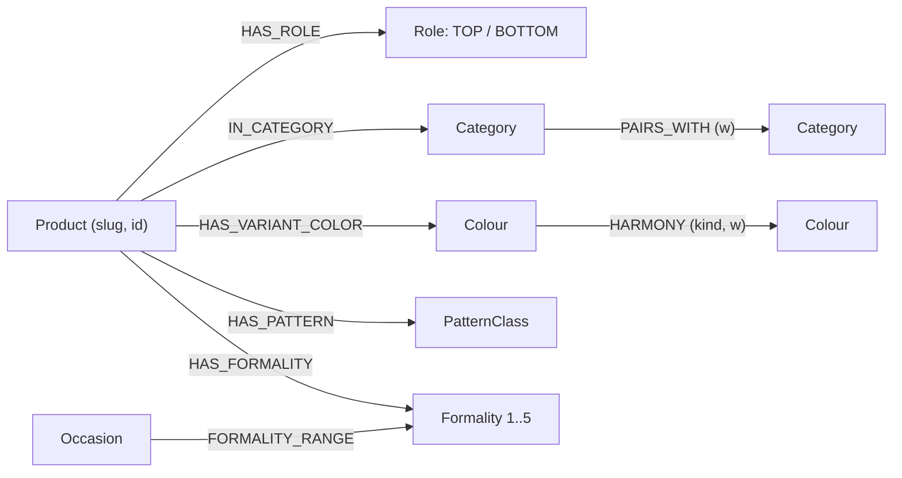

# Thiết kế: Outfit Knowledge Graph (phối áo + quần/váy)

## 1. Các quyết định đã chốt

| # | Chủ đề | Quyết định |
|---|---|---|
| Q1 | Phạm vi | Áo chính: **Áo thun, Áo polo, Áo sơ mi**. Áo khoác chỉ làm áo chính khi khách hỏi đúng món áo khoác. Quần/váy: **Jeans, Kaki, Short, Quần âu, Chân váy**. Loại khỏi phạm vi: Váy liền, Đầm dạ hội, phụ kiện |
| Q2 | Mức chi tiết | Gợi ý ở mức **sản phẩm + màu biến thể**. **Không lọc theo tồn kho**, chỉ trả kèm `in_stock` để LLM nhắc khách |
| Q3 | Họa tiết | Script offline join `hm_seed_1000.json` với parquet qua `hmProductCode`, lấy họa tiết từ `graphical_appearance_name` !!!!!!!!!!????????? | 
| Q4 | Độ trang trọng / dịp mặc | Thang 1–5 gán theo category, điều chỉnh ±1 bằng từ khóa trong description. Mỗi dịp mặc ánh xạ vào một khoảng độ trang trọng |
| Q5 | Màu | Mỗi màu có thuộc tính {nhóm màu, trung tính, sáng/tối, rực}, áp 4 quy tắc chung và danh sách cặp kinh điển |
| Q6 | Giới tính | **Ràng buộc cứng**: cùng `targetGender` hoặc UNISEX, lấy theo món gốc. Chân váy chỉ dành cho FEMALE |
| Q7 | Kiến trúc | Đồ thị dựng lazy từ BE qua `ShopClient` ở lần gọi đầu, cache trong RAM có TTL, join với file thuộc tính qua **slug**, chấm điểm lúc chạy. Không thêm dependency |
| Q8 | Chế độ | Một tool `suggest_outfit`: có `product_id` thì chạy Mode A (có món gốc), không có thì chạy Mode B (theo dịp + giới tính) |
| Q9 | Cá nhân hóa | `dislikedColors`: loại cứng. `favoriteColors`: cộng điểm nhẹ. `frequentOccasions`: dịp mặc mặc định. Chưa dùng `styles` |
| Q10 | Đánh giá | Unit test quy tắc, 15–20 câu eval (tỷ lệ vi phạm và grounding, baseline so với KG), bảng chấm tay 1–5 |
| Q11 | API | Thêm trường tùy chọn `outfits` vào `ChatResponse`, giữ `recommended_products`. FE làm sau |

## 2. Dữ liệu thực tế (đã khảo sát)

- **BE (Prisma)**: `Product` gồm name, slug, description, targetGender, category, material, season. Màu nằm ở `ProductVariant.color/colorHex/stock`. Không có trường họa tiết hay độ trang trọng.
- **Seed**: 1000 sản phẩm, slug có dạng `hm-<hmProductCode>-xxxxxx`, 70% sản phẩm có 3 màu. Có 33 tên màu tiếng Việt.
- **Parquet**: join được 1000/1000 sản phẩm. Họa tiết: Solid 574, All-over pattern 121, Denim 85, Melange 78, Stripe 31, Check 28, các loại khác ít.

## 3. Schema đồ thị



### 3.1 Category: vai trò, độ trang trọng gốc, ma trận PAIRS_WITH

| Áo \ Quần/váy | Jeans (2) | Kaki (3) | Short (1) | Quần âu (5) | Chân váy (3) |
|---|---|---|---|---|---|
| **Thun (1)** | 1.0 | 0.7 | 1.0 | 0.2 | 0.8 |
| **Polo (3)** | 0.8 | 1.0 | 0.8 | 0.5 | 0.6 |
| **Sơ mi (4)** | 0.8 | 0.9 | 0.4 | 1.0 | 0.9 |
| **Khoác (3)** | 1.0 | 0.9 | 0.5 | 0.7 | 0.7 |

> [!NOTE]
> Đây là các giá trị khởi đầu. Chúng nằm trong file `rules.json` để tinh chỉnh sau khi có kết quả chấm tay.

### 3.2 Phân lớp họa tiết

| PatternClass | Các giá trị H&M | Quy tắc |
|---|---|---|
| `SOLID` | Solid, Melange, Denim, Treatment, Other structure | Đi được với mọi lớp |
| `PATTERN` | All over pattern, Stripe, Check, Placement print, Colour blocking, Lace, Embroidery… | `PATTERN` + `PATTERN` bị **trừ điểm mạnh** (không loại hẳn) |

### 3.3 Màu

- `colours.json`: ánh xạ 33 tên màu sang `{family, neutral, lightness: light|mid|dark, loud}`. Ví dụ: `Xanh navy → {blue, neutral: true, dark}`, `Đỏ tươi → {red, loud: true, mid}`.
- Quy tắc:
  - (a) có ít nhất một màu trung tính: +
  - (b) tương phản sáng/tối: +
  - (c) cả hai màu đều rực: −
  - (d) cùng nhóm màu (tone-sur-tone): + nhẹ
  - Cặp kinh điển (Navy–Be, Trắng–Navy, Đen–Trắng, Xanh rêu–Be, Trắng–Xanh lam nhạt…): ++

### 3.4 Dịp mặc → khoảng độ trang trọng

`đi biển/du lịch: 1–2` · `đi chơi/dạo phố: 1–3` · `đi học: 1–3` · `hẹn hò: 2–4` · `smart-casual/cà phê: 2–4` · `công sở: 3–5` · `gặp khách/họp: 4–5`

## 4. Hàm chấm điểm

1. **Bộ lọc cứng**: đúng cặp vai trò (TOP với BOTTOM) · ràng buộc giới tính · loại màu nằm trong `dislikedColors` · |Δ độ trang trọng| ≤ 2 · nếu có dịp mặc thì cả hai món phải nằm trong khoảng độ trang trọng của dịp đó (cho phép lệch ±1).

2. **Điểm mềm** (tính cho từng cặp sản phẩm + màu):

$$S = 0.30\,C_{cat} + 0.30\,C_{colour} + 0.15\,C_{pattern} + 0.20\,C_{formality} + 0.05\,C_{fav}$$

3. Mỗi cặp sản phẩm chỉ giữ **cặp màu tốt nhất**. Đa dạng hóa kết quả bằng cách không lặp lại cùng một sản phẩm trong top-k.

## 5. Hợp đồng tool

```python
suggest_outfit(product_id: int | None, color: str | None, occasion: str | None,
               gender: GenderTarget | None, limit: int = 3) -> OutfitResult
```

```json
{"mode": "anchor", "outfits": [{
  "top": {"product_id": 12, "name": "...", "color": "Xanh navy", "in_stock": true},
  "bottom": {"product_id": 431, "name": "...", "color": "Be sữa", "in_stock": false},
  "score": 0.86,
  "reasons": ["Polo + Kaki: bộ smart-casual chuẩn", "Navy – Be: cặp màu kinh điển",
              "Cả hai đều trơn nên dễ phối", "Độ trang trọng 3–3 phù hợp đi làm"]}]}
```

Bổ sung vào system prompt: *"Khi khách hỏi phối đồ, BẮT BUỘC gọi `suggest_outfit`. Chỉ giới thiệu những bộ mà tool trả về, diễn giải dựa trên `reasons`, nhắc khách nếu món nào `in_stock = false`."*

## 6. Kế hoạch file

| File | Nội dung |
|---|---|
| `scripts/build_outfit_kg.py` | Offline: seed + parquet → `data/outfit_kg/product_attrs.json` (key là slug: role, pattern_class, formality) |
| `data/outfit_kg/rules.json` | Ma trận category, quy tắc họa tiết, dịp mặc → độ trang trọng, từ khóa ±1 |
| `data/outfit_kg/colours.json` | Thuộc tính của 33 màu và các cặp kinh điển |
| `services/outfit_rules.py` | Load rules và hàm tính điểm, bộ lọc thuần |
| `services/outfit_graph.py` | Dựng đồ thị lazy, cache TTL, bộ lọc, chấm điểm, sinh `reasons` |
| `tools/outfit_tool.py` | `@tool suggest_outfit` → đăng ký vào `ALL_TOOLS` |
| `schemas/chat.py` | Thêm `OutfitItem`, `OutfitSuggestion`; thêm `ChatResponse.outfits` |
| `services/clarification_policy.py` / prompt | Thêm chỉ dẫn gọi tool |
| `tests/test_outfit_rules.py`, `tests/test_outfit_graph.py` | Unit test quy tắc, bộ lọc cứng, graph và tool |
| `eval/questions.json` | Thêm 15 câu phối đồ (Mode A/B, nam/nữ, các dịp) |
| `eval/` metrics | Tỷ lệ vi phạm quy tắc, grounding, cấu hình baseline so với KG |
| `docs/plans/prd.md`, `AGENTS.md`, `README.md` | Đồng bộ tài liệu |
