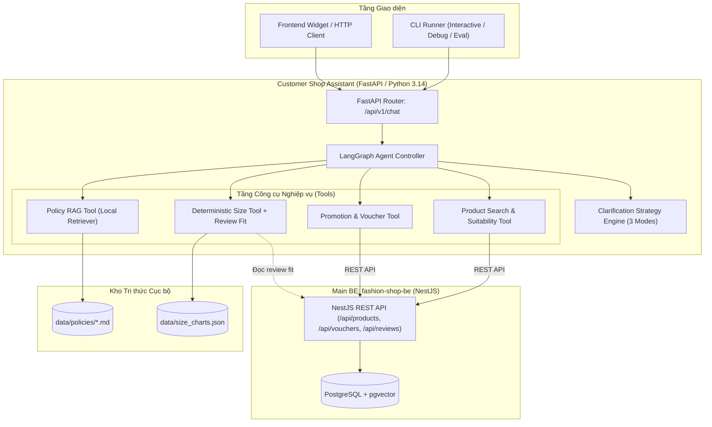

# PRD: Chatbot tư vấn khách hàng shop thời trang (Customer Shop Assistant)

Phiên bản 1.1 (Cập nhật toàn diện: Tư vấn chọn sản phẩm phù hợp & Tư vấn size) · 16/10/2026 · Trạng thái: Đã thống nhất

---

## 1. Tóm tắt

Xây dựng hệ sinh thái chatbot tư vấn khách hàng cho shop bán lẻ thời trang, phục vụ qua **FastAPI REST API (`/api/chat`)** kết hợp công cụ **CLI tương tác và chạy evaluation hàng loạt** cho nhà phát triển. Chatbot đóng vai trò như một **Trợ lý tư vấn thời trang thông minh (Fashion Stylist & Shopping Assistant)**, giao tiếp bằng tiếng Việt theo phong cách **tối giản, trực diện (Fact-first)**, tiết kiệm tối đa token và giảm độ trễ phản hồi trên phần cứng GPU local 6–8GB VRAM.

Chatbot giải quyết hai bài toán tư vấn cốt lõi:
1. **Tư vấn lựa chọn sản phẩm phù hợp (Product Suitability Advisory)**: Gợi ý sản phẩm dựa trên hoàn cảnh sử dụng (đi làm, đi chơi, dự tiệc...), vóc dáng cơ thể (gầy cao, đầy đặn, che khuyết điểm), đặc tính chất liệu/thời tiết và gợi ý phối đồ cơ bản (mix & match giữa áo và quần/váy).
2. **Tư vấn chọn size chuẩn xác (Size & Fit Recommendation)**: Tính toán size tối ưu bằng công cụ tất định theo bảng quy chuẩn số đo, kết hợp phản hồi thực tế về form dáng (`fit`: chật/chuẩn/rộng) từ đánh giá của khách hàng cũ.

Hệ thống kết nối trực tiếp với **REST API của Main BE ([fashion-shop-be](file:///H:/Code/PET/e-commerce-clothes/fashion-shop-be))** để truy xuất dữ kiện chuẩn xác (giá sau giảm, tồn kho, khuyến mãi, voucher) và tìm kiếm sản phẩm kết hợp ngữ nghĩa thông qua chỉ mục **pgvector** trên PostgreSQL. Kiến thức chính sách shop (đổi trả, vận chuyển, giặt ủi, FAQ) được quản lý qua **RAG nội bộ** với tài liệu Markdown/JSON có trích dẫn nguồn.

Dự án đồng thời là nền tảng **nghiên cứu thực nghiệm về chiến lược hỏi lại làm rõ (Clarification Strategy)** với 3 chế độ cấu hình linh hoạt cho cả tư vấn sản phẩm lẫn tư vấn size.

---

## 2. Bối cảnh & Khảo sát hệ thống

- **Main BE ([fashion-shop-be](file:///H:/Code/PET/e-commerce-clothes/fashion-shop-be))**:
  - NestJS 11 + Prisma ORM 7 + PostgreSQL.
  - Quản lý đầy đủ danh mục cây (`Category`: Áo, Quần, Váy & Đầm, Phụ kiện), thương hiệu (`Brand`), sản phẩm (`Product` có chất liệu `material`, hướng dẫn giặt `careInstructions`, mùa `season`) và biến thể (`ProductVariant` gồm size, màu sắc, mã hex, giá niêm yết, giá bán, tồn kho, trọng lượng).
  - Quản lý khuyến mãi (`Campaign`, `Discount`, `Voucher`), đơn hàng, thanh toán và đánh giá (`Review` chứa trường `fit`: `TIGHT` / `TRUE_TO_SIZE` / `LOOSE`, kèm `userHeight`, `userWeight` của người mua).
  - Main BE chịu trách nhiệm tính toán giá sau giảm, quản lý tồn kho và cung cấp các endpoint tìm kiếm semantic/hybrid qua tiện ích mở rộng **pgvector** trong PostgreSQL.
- **Chatbot Backend ([customer-shop-assistant](file:///h:/Code/PET/customer-shop-assistant))**:
  - Python >= 3.14 quản lý bởi `uv`, FastAPI, Uvicorn, LangChain / LangGraph, Pydantic v2.
  - Hỗ trợ linh hoạt LLM local qua Ollama (`llama3.2`) hoặc LM Studio (`google/gemma-4-e2b`, OpenAI-compatible).
  - Kho tài liệu nghiệp vụ tham chiếu: [docs/requirements/bussiness.md](file:///h:/Code/PET/customer-shop-assistant/docs/requirements/bussiness.md).

---

## 3. Mục tiêu và ngoài phạm vi

### 3.1 Mục tiêu v1 (In-Scope)
- **G1. Tư vấn thời trang & chọn size toàn diện**: Chatbot có khả năng hiểu các nhu cầu tự nhiên, trừu tượng về phong cách, vóc dáng, chất liệu, hoàn cảnh để gợi ý sản phẩm phù hợp, kèm đề xuất size chuẩn xác có căn cứ.
- **G2. Đa giao diện truy cập**: Lõi Agent độc lập, phục vụ qua FastAPI (`/api/chat` hỗ trợ JSON / SSE streaming) song song với CLI runner phục vụ thử nghiệm và đánh giá chất lượng.
- **G3. Tích hợp trực tiếp Main BE**: Truy xuất 100% dữ kiện thời trang từ live REST API của `fashion-shop-be`, không dùng database độc lập và không để LLM tự viết SQL.
- **G4. Nghiên cứu thực nghiệm Clarification**: Hỗ trợ 3 chế độ hỏi lại cấu hình linh hoạt (`IMMEDIATE_ANSWER`, `MINIMAL_CLARIFICATION`, `ALWAYS_CLARIFY`) áp dụng cho cả luồng tư vấn sản phẩm lẫn tư vấn size để đo lường hiệu quả tương tác.
- **G5. RAG chính sách minh bạch**: Truy xuất tài liệu chính sách nội bộ qua RAG, trích dẫn chính xác điều khoản, từ chối trung thực khi không có dữ liệu.
- **G6. Bộ đánh giá Golden Set**: Tự động hóa kiểm thử với 40–120 câu hỏi đánh giá tính trung thực dữ kiện, năng lực tư vấn sản phẩm/size, các edge cases khuyến mãi và độ tuân thủ chế độ hỏi lại.

### 3.2 Ngoài mục tiêu v1 (Out of Scope)
- Tra cứu dữ liệu cá nhân, thông tin đơn hàng, số dư tài khoản hoặc thao tác đổi địa chỉ (cần đăng nhập / bảo mật người dùng).
- Thực hiện giao dịch thay khách hàng (thêm giỏ hàng, bấm đặt hàng, áp voucher thanh toán).
- Đa kênh bên ngoài (Zalo OA, Facebook Messenger, Telegram) hoặc giao diện web widget hoàn chỉnh (sẽ triển khai ở v2 dựa trên FastAPI endpoint của v1).
- Xử lý hình ảnh (Vision multimodal) hoặc thử đồ ảo (Virtual Try-On).

---

## 4. Persona & Người dùng mục tiêu

### 4.1 Persona của Chatbot: "Minimalist / Fact-first Fashion Assistant"
- **Giọng điệu**: Tối giản, trực diện, lịch thiệp và khách quan.
- **Xưng hô**: "mình - bạn".
- **Nguyên tắc trả lời**:
  - Trả lời thẳng vào dữ kiện và gợi ý cốt lõi (tên mẫu, kiểu dáng phù hợp, chất liệu, giá sau giảm, tình trạng tồn kho, size đề xuất).
  - Không rào đón, không xã giao kéo dài, không dùng văn mẫu quảng cáo sáo rỗng để tiết kiệm token tối đa và giảm độ trễ trên phần cứng GPU 6–8GB VRAM.
  - Sử dụng định dạng tiền tệ quen thuộc (ví dụ: `250.000đ`).

### 4.2 Câu hỏi mẫu điển hình
1. *Tư vấn theo hoàn cảnh*: "Mình cần tìm set đồ đi làm công sở lịch sự nhưng trẻ trung, thoải mái."
2. *Tư vấn theo vóc dáng*: "Mình nam cao 1m75 nặng 56kg hơi gầy, nên mặc áo form gì cho đỡ gầy?"
3. *Tư vấn chất liệu / thời tiết*: "Shop có áo thun nào chất vải mát, thấm hút mồ hôi tốt mặc đi biển không?"
4. *Gợi ý phối đồ (Mix & Match)*: "Áo polo pique màu xanh navy này phối với quần gì thì đẹp?"
5. *Tư vấn size kết hợp*: "Mình 1m70, 65kg thích mặc vừa người thì áo sơ mi Oxford này lấy size nào?"
6. *Khuyến mãi*: "Hiện tại có voucher nào áp dụng được cho đơn 400k không?"
7. *Chính sách*: "Nếu mua về mặc không vừa size shop có hỗ trợ đổi không, phí ship thế nào?"
8. *Hết hàng*: "Mẫu áo khoác bomber nỉ màu đen size L còn không?"
9. *Ngoài phạm vi*: "Kiểm tra giùm mình đơn hàng vừa đặt hôm qua với."

---

## 5. Yêu cầu chức năng chi tiết

### FR-1. Tư vấn lựa chọn sản phẩm phù hợp (Product Suitability Advisory) & Tìm kiếm thông minh

Chatbot không chỉ thực hiện tìm kiếm từ khóa đơn thuần mà phải đóng vai trò tư vấn lựa chọn sản phẩm phù hợp cho khách hàng:

1. **Tư vấn theo hoàn cảnh sử dụng (Occasion)**:
   - *Công sở / Đi làm*: Gợi ý áo sơ mi Oxford, quần âu xếp ly, quần kaki ống đứng, áo khoác blazer, đầm công sở thắt nơ eo.
   - *Đi chơi / Dạo phố*: Gợi ý áo thun cotton, áo polo thể thao, quần jeans slim fit / ống rộng, quần short, chân váy xếp ly.
   - *Dự tiệc / Sự kiện*: Gợi ý đầm dạ hội ren thêu hoa, đầm xòe lụa, blazer phối quần tây thanh lịch.
   - *Vận động / Du lịch / Đi biển*: Gợi ý áo polo co giãn 4 chiều, quần short thoáng khí quick-dry, sơ mi họa tiết rayon, mũ bucket.
2. **Tư vấn theo vóc dáng & phom người (Body Fit & Silhouettes)**:
   - *Dáng gầy, cao*: Gợi ý dáng Regular Fit, cổ tròn, màu sáng (trắng, be, xám tiêu), họa tiết ngang hoặc chất vải dày dặn có phom (như Cotton 250gsm, Kaki) để tạo cảm giác đầy đặn hơn; tránh áo quá bó sát.
   - *Dáng đậm người, có bụng*: Gợi ý các tone màu tối (đen, xanh navy), form Regular hoặc suông nhẹ, chất vải đứng phom (Cotton compact, Oxford), tránh vải quá rủ hoặc bó sát vùng bụng.
   - *Chiều cao khiêm tốn*: Gợi ý quần cạp cao, quần short trên gối, áo có chiều dài vừa phải ngang hông để tôn dáng.
3. **Tư vấn theo chất liệu & thời tiết (Material & Seasonality)**:
   - *Mùa hè / Nắng nóng*: Ưu tiên 100% Cotton Compact, Rayon, Linen thoáng mát, thấm hút tốt.
   - *Mùa đông / Se lạnh*: Ưu tiên nỉ bông (Hoodie 320gsm), áo khoác gió tráng PU, áo bomber lót bông giữ ấm.
4. **Gợi ý phối đồ cơ bản (Basic Mix & Match)**:
   - Khi khách hỏi phối đồ hoặc hỏi set đồ hoàn chỉnh, chatbot gợi ý kết hợp hợp lý giữa nhóm Áo và nhóm Quần/Váy có sẵn trong catalog của shop (ví dụ: Áo polo xanh navy phối cùng Quần kaki be sữa hoặc Quần short chino; Áo sơ mi Oxford phối cùng Quần tây âu hoặc Quần jeans slim-fit).
5. **Quy tắc hiển thị tồn kho & giá**:
   - Khi tìm kiếm/gợi ý chung: **Chỉ đề xuất sản phẩm/biến thể còn hàng (`stock > 0`)**.
   - Khi khách hỏi đích danh mẫu/size đã hết hàng: **Trung thực thông báo hết hàng và chủ động đề xuất 1–2 mẫu thay thế tương đương còn hàng**.
   - Luôn hiển thị **giá sau giảm** lấy từ kết quả API của Main BE.

### FR-2. Nghiên cứu thực nghiệm Clarification Modes (Áp dụng cho Tư vấn Sản phẩm & Size)

Hệ thống hỗ trợ tham số cấu hình `CLARIFICATION_MODE` (cấu hình qua Settings hoặc payload từng request) để nghiên cứu hành vi hỏi lại:

1. **`IMMEDIATE_ANSWER` (Trả lời ngay)**:
   - *Tư vấn sản phẩm*: Đề xuất ngay 2–3 sản phẩm phù hợp nhất từ catalog dựa trên thông tin hiện có, giải thích lý do ngắn gọn, không hỏi thêm.
   - *Tư vấn size*: Đưa ra size ước tính hoặc bảng size chuẩn để khách tự đối chiếu, không hỏi lại số đo.
2. **`MINIMAL_CLARIFICATION` (Hỏi lại tối thiểu - Mặc định)**:
   - Với yêu cầu sản phẩm đã có tiêu chí (dù là mơ hồ như "áo thun mát đi biển", "quần jeans đi làm"): Tìm và đề xuất ngay.
   - Chỉ đặt **tối đa 1 câu hỏi làm rõ** khi thông tin hoàn toàn không đủ để đưa ra câu trả lời có nghĩa:
     + Khi khách nhờ tư vấn chung chung không có bối cảnh (ví dụ: *"Tư vấn đồ cho mình với"*): Hỏi 1 câu ngắn gọn về dịp mặc (đi làm, đi chơi hay dự tiệc) hoặc phong cách/ngân sách mong muốn.
     + Khi khách hỏi trực tiếp về chọn size (ví dụ: *"Áo này mình mặc size gì?"*): Hỏi 1 câu ngắn gọn về chiều cao, cân nặng và form dáng yêu thích (ôm, vừa hay rộng).
3. **`ALWAYS_CLARIFY` (Luôn hỏi làm rõ)**:
   - Luôn chủ động đặt câu hỏi làm rõ nhu cầu (chiều cao, cân nặng, hoàn cảnh sử dụng, sở thích màu sắc/form dáng) trước khi đưa ra gợi ý sản phẩm hoặc size cụ thể.

### FR-3. Cơ chế tính toán và tư vấn chọn size (Size & Fit Recommendation)
- **Công cụ tính size tất định (Deterministic Rule-based Tool)**:
  - Dựa trên file quy chuẩn [data/size_charts.json](file:///h:/Code/PET/customer-shop-assistant/data) phân tách theo danh mục (Áo nam, Áo nữ, Quần nam, Quần nữ, Váy đầm) và đối tượng (`targetGender`).
  - Đề xuất 1–2 size phù hợp kèm mức độ chắc chắn. Trường hợp số đo nằm giữa hai size, đưa ra cả hai và hướng dẫn dựa trên sở thích mặc ôm hay rộng.
- **Tín hiệu phản hồi thực tế từ Review (`fit`)**:
  - Khi sản phẩm có ít nhất 10 đánh giá (`reviewCount >= 10`), công cụ kiểm tra tỷ lệ đánh giá `fit` (`TIGHT`, `TRUE_TO_SIZE`, `LOOSE`) từ khách hàng cũ.
  - Đưa ra khuyến nghị bổ sung mang tính tham khảo (ví dụ: *"Mẫu áo này có 15 đánh giá, đa số khách nhận xét form hơi ôm (tight), nếu bạn thích mặc thoải mái thì nên cân nhắc tăng lên 1 size L nhé"*).
  - Tuyệt đối không khẳng định chắc chắn 100% nếu sản phẩm chưa đủ dữ liệu đánh giá.

### FR-4. Khuyến mãi & Vouchers
- Tra cứu danh sách chiến dịch khuyến mãi (`Campaign`), giảm giá trực tiếp theo sản phẩm (`Discount`).
- Kiểm tra điều kiện áp dụng Voucher theo mã code:
  - Tồn tại, đang active, trong thời gian hiệu lực (`startsAt` - `endsAt`).
  - Đạt giá trị đơn hàng tối thiểu (`minOrderAmount`).
  - Còn ngân sách hoặc lượt sử dụng (`maxUses`, `usedCount`).
- **Không tự suy diễn giá**: Mọi con số giảm trừ và giá thanh toán phải từ API Main BE.

### FR-5. Chính sách & FAQ (RAG cục bộ)
- Trả lời các thắc mắc về: Đổi trả hàng, Phí & thời gian vận chuyển, Phương thức thanh toán (COD, VietQR, Chuyển khoản), Hướng dẫn giặt ủi và bảo quản.
- Dữ liệu được truy xuất qua RAG từ kho tài liệu cục bộ tại `data/policies/`.
- Câu trả lời phải **trích dẫn tên chính sách/điều khoản**. Không có thông tin thì trả lời rõ ràng là shop chưa có quy định cho trường hợp đó, tuyệt đối không bịa đặt.

### FR-6. Xử lý yêu cầu ngoài phạm vi
- Khi khách hỏi tra cứu đơn hàng cá nhân, thanh toán chuyển khoản đơn hàng cụ thể, hoặc các vấn đề không liên quan:
  - Phản hồi ngắn gọn, rõ ràng: *"Hiện tại mình chưa hỗ trợ tra cứu đơn hàng/thao tác cá nhân. Bạn vui lòng liên hệ nhân viên shop để được hỗ trợ nhé."*

### FR-7. Giao thức tương tác & Ghi log
- **FastAPI API**: Endpoint `POST /api/chat` nhận payload (session_id, message, clarification_mode) và trả về text response kèm metadata (tool calls, products suggested).
- **CLI Runner**:
  - `uv run customer-shop-assistant chat`: Giao diện dòng lệnh tương tác trực tiếp.
  - `uv run customer-shop-assistant chat --debug`: Hiển thị chi tiết các bước Agent, Tool call, tham số và đoạn text RAG.
  - `uv run customer-shop-assistant eval`: Chạy tự động bộ câu hỏi đánh giá.
- **Telemetry Logging**: Ghi chi tiết từng turn vào `logs/chat_turns.jsonl` (session_id, user_message, clarification_mode, tool_calls, retrieved_docs, latency_ms, token_usage, final_response).

---

## 6. Hợp đồng dữ liệu & Tích hợp Main BE

### 6.1 Yêu cầu bổ sung phía Main BE ([fashion-shop-be](file:///H:/Code/PET/e-commerce-clothes/fashion-shop-be))
Để hỗ trợ Chatbot vận hành tối ưu, Main BE cần cung cấp:
1. **Thuộc tính đối tượng (`targetGender`)**:
   - Thêm enum `GenderTarget { MALE, FEMALE, UNISEX }` vào bảng `Product` trong [schema.prisma](file:///H:/Code/PET/e-commerce-clothes/fashion-shop-be/prisma/schema.prisma).
2. **Endpoint Semantic/Hybrid Search qua pgvector**:
   - Cài đặt extension `pgvector` trên PostgreSQL của shop.
   - Bổ sung endpoint `GET /api/products/search?q=...&gender=...&minPrice=...&maxPrice=...&inStock=true` thực thi tìm kiếm kết hợp ngữ nghĩa và bộ lọc cứng.
3. **Các endpoint chuẩn hiện có**:
   - `GET /api/products/:id`: Chi tiết sản phẩm, biến thể, giá bán sau giảm, tồn kho, chất liệu, mùa, hướng dẫn giặt.
   - `GET /api/vouchers/check?code=...&orderAmount=...`: Kiểm tra tính hợp lệ của voucher.
   - `GET /api/discounts`: Danh sách khuyến mãi đang diễn ra.
   - `GET /api/reviews/product/:id`: Danh sách đánh giá kèm số đo chiều cao/cân nặng và nhận xét form dáng (`fit`).

### 6.2 Dữ liệu nội bộ của Chatbot Assistant
1. **`data/size_charts.json` (D1)**: Bảng chuẩn quy đổi chiều cao, cân nặng, vòng ngực/bụng sang size cho Áo nam, Áo nữ, Quần nam, Quần nữ, Váy đầm.
2. **`data/policies/*.md` (D2)**: Tài liệu chi tiết về vận chuyển (`shipping.md`), đổi trả hàng (`returns.md`), thanh toán (`payment.md`) và bảo quản đồ (`care_guide.md`).
3. **`eval/questions.json` (D4)**: Bộ Golden Set câu hỏi kiểm thử bao quát cả tư vấn sản phẩm, chọn size, khuyến mãi và chính sách.

---

## 7. Kiến trúc phần mềm đề xuất

- **Điều phối (Orchestration)**: Vòng lặp ReAct / Tool-calling async Python thuần túy qua `BaseChatModel.bind_tools(ALL_TOOLS)`. Toàn bộ luồng suy luận, hỏi lại (clarification mode) và gọi công cụ được điều khiển tự nhiên bởi LLM và System Prompt, không sử dụng các khối heuristic cứng và LangGraph cồng kềnh. Các thuật toán heuristic (`classify_intent`, `ClarificationEngine`) được cô lập riêng trong `customer_shop_assistant.eval.heuristics` để phục vụ benchmark tự động.
- **Ràng buộc an toàn**: Giới hạn tối đa 5 bước suy luận (steps limit) mỗi turn, timeout kết nối API 3.0s.

---

## 8. Đánh giá chất lượng (Evaluation) & Bộ chỉ số

### 8.1 Cấu trúc bộ câu hỏi Golden Set (`eval/questions.json`)
Quy mô từ 40 câu mở rộng lên 120 câu, phân bổ theo các nhóm trọng tâm:
1. **Nhóm Tư vấn Lựa chọn Sản phẩm phù hợp (Product Suitability)**:
   - Tư vấn theo vóc dáng (người gầy cao, người đậm có bụng).
   - Tư vấn theo hoàn cảnh (đi làm công sở, đi tiệc, đi chơi/đi biển).
   - Tư vấn theo chất liệu & tính năng (vải thoáng mát mùa hè, vải ấm mùa đông, vải ít nhăn).
   - Gợi ý phối đồ (áo kết hợp với quần/váy phù hợp trong shop).
2. **Nhóm Kiểm thử 3 Chế độ hỏi lại (Clarification Evaluation)**:
   - Cùng một yêu cầu tư vấn sản phẩm hoặc size (ví dụ: *"Tìm áo đi làm"*, *"Mình mặc size gì"*), chạy qua cả 3 chế độ (`IMMEDIATE_ANSWER`, `MINIMAL_CLARIFICATION`, `ALWAYS_CLARIFY`) để đo số lượt tương tác, số token tiêu tốn và tỷ lệ chốt được gợi ý phù hợp.
3. **Nhóm Tư vấn Size & Review Fit**:
   - Số đo chuẩn một size (1m70, 62kg -> size M).
   - Số đo nằm giữa 2 size (1m72, 65kg -> đề xuất M hoặc L).
   - Sản phẩm có review báo form ôm/rộng (`fit: TIGHT | LOOSE`).
4. **Nhóm Kiểm thử Edge Cases Khuyến mãi & Voucher**:
   - Hỏi voucher hết hạn, chưa đủ giá trị đơn hàng tối thiểu.
   - Hỏi giải thích lý do giảm giá của sản phẩm.
5. **Nhóm Kiểm thử Xử lý Hàng hết tồn kho**:
   - Hỏi mẫu/size có `stock = 0`, kiểm tra phản hồi thông báo hết hàng và gợi ý mẫu thay thế còn hàng.
6. **Nhóm Từ chối ngoài phạm vi**:
   - Hỏi tra cứu đơn hàng cá nhân, huỷ đơn, khiếu nại.

### 8.2 Tiêu chí & Ngưỡng nghiệm thu

| Chỉ số kiểm thử | Phương pháp đo | Ngưỡng mục tiêu |
| :--- | :--- | :--- |
| **Tính trung thực dữ kiện** (Giá sau giảm, tồn kho, voucher) | Đối chiếu tự động với kết quả trả về từ API Main BE | $\ge 95\%$ |
| **Độ phù hợp của sản phẩm tư vấn** (Suitability score) | Đánh giá độ khớp với hoàn cảnh/vóc dáng/chất liệu yêu cầu | $\ge 85\%$ |
| **Chọn đúng Tool & Tham số** | Kiểm tra chuỗi tool calls theo ground-truth | $\ge 85\%$ |
| **Độ chính xác RAG Chính sách** | Top-3 chunk chứa đúng căn cứ chính sách | $\ge 85\%$ |
| **Hành vi xử lý hàng hết tồn kho** | Đúng mẫu hết hàng, có gợi ý mẫu thay thế còn hàng | $\ge 90\%$ |
| **Tuân thủ Chế độ hỏi lại** (Clarification compliance) | Kiểm tra hành vi hỏi lại tương ứng với mode đang bật | $\ge 95\%$ |
| **Từ chối đúng ngoài phạm vi** | Nhận diện và từ chối lịch thiệp, không bịa thông tin | $\ge 95\%$ |
| **Độ trễ phản hồi (Latency)** | Đo thời gian xử lý mỗi turn trên GPU 6–8GB VRAM | $< 4.0\text{s}$ |

---

## 9. Kế hoạch thí nghiệm học tập (Research Experiments)

- **E1. Nghiên cứu chiến lược hỏi lại (Clarification Strategy)**: So sánh 3 chế độ (`IMMEDIATE_ANSWER`, `MINIMAL_CLARIFICATION`, `ALWAYS_CLARIFY`) trên cả 2 tác vụ: tư vấn sản phẩm phù hợp và tư vấn size (đo số turn hoàn thành, tổng token, độ trễ và tỷ lệ hài lòng).
- **E2. Năng lực tư vấn thời trang của LLM Local**: Đo lường khả năng suy luận chọn đồ theo vóc dáng, chất liệu và phối đồ của model 7B–8B (`llama3.2` vs `gemma-4-e2b`).
- **E3. So sánh kiến trúc Agent**: ReAct đơn vòng lặp vs Router phân loại ý định + Subgraphs chuyên biệt.
- **E4. Tối ưu hoá RAG Chính sách**: So sánh kích thước chunk và giá trị Top-k.
- **E5. Nghiên cứu Persona & Prompting**: Hiệu quả giảm token và độ trễ của phong cách "Minimalist / Fact-first" so với phong cách tư vấn rườm rà.

---

## 10. Lộ trình triển khai (Milestones)

- **M0. Chuẩn bị & Data Contract**:
  - Thống nhất hợp đồng API với `fashion-shop-be` (bổ sung `targetGender` và endpoint search pgvector).
  - Soạn thảo `data/size_charts.json` và bộ chính sách `data/policies/*.md`.
- **M1. Lõi Tích hợp & Tools cơ bản**:
  - Xây dựng HTTP Client kết nối API `fashion-shop-be`.
  - Xây dựng Tool Tư vấn Chọn sản phẩm & Tìm kiếm thông minh.
  - Xây dựng Tool Tư vấn Size tất định kết hợp Review fit signal.
  - Xây dựng Tool Khuyến mãi / Voucher.
- **M2. Tầng RAG Chính sách & Clarification Engine**:
  - Triển khai RAG nội bộ cho chính sách shop.
  - Cài đặt bộ điều phối 3 chế độ hỏi lại (`CLARIFICATION_MODE`) cho cả tư vấn sản phẩm và size.
- **M3. FastAPI Router & CLI Runner**:
  - Hoàn thiện endpoint `/api/v1/chat` và giao diện dòng lệnh CLI (interactive & debug).
  - Hoàn thiện hệ thống telemetry logging (`logs/chat_turns.jsonl`).
- **M4. Xây dựng Bộ Eval & Chạy thực nghiệm**:
  - Dựng bộ 40–120 câu hỏi Golden Set kiểm thử tự động.
  - Thực hiện các thí nghiệm E1–E5, tổng hợp số liệu báo cáo nghiên cứu.
