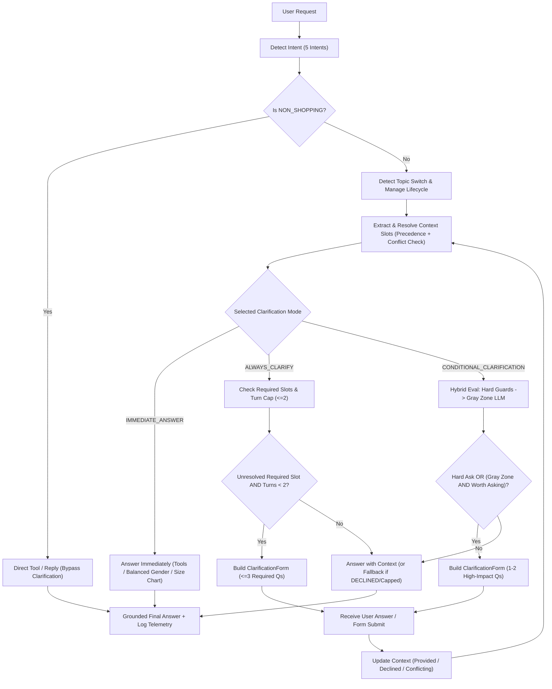

# Specification: Clarification Questions & Clarification Modes

- **Tài liệu:** Clarification Strategy Specification
- **Phiên bản:** 1.1
- **Trạng thái:** Approved (Source of Truth)
- **Phạm vi áp dụng:** `customer-shop-assistant` — Chatbot tư vấn lựa chọn sản phẩm, phối đồ (Outfit KG) và chọn size thời trang (catalog-grounded)
- **Tài liệu liên quan:** `docs/plans/prd.md`, `docs/specs/outfit-kg-clarification-spec.md` (Category-level Outfit KG & Counterfactual Clarification Policy cho `OUTFIT_ADVICE`)
- **Ngôn ngữ:** Tiếng Việt

---

## 1. Mục đích & Vai trò tài liệu

Tài liệu này là **chuẩn đích (Source of Truth)** cho toàn bộ thiết kế, triển khai và thực nghiệm chiến lược hỏi làm rõ trong `customer-shop-assistant` (bao gồm slot tracking, clarification policy, clarification form planner, agent orchestration, telemetry và bộ đánh giá E1).

Tài liệu định nghĩa thống nhất:

1. Clarification Question (câu hỏi làm rõ) là gì và khi nào hệ thống nên hoặc không nên hỏi.
2. Danh sách 5 Intent thực tế, ma trận Context Slot (`Required` / `Conditional` / `Optional`), trạng thái slot và vòng đời ngữ cảnh đa lượt.
3. Hành vi chuẩn của ba Clarification Modes:
   - `IMMEDIATE_ANSWER`
   - `ALWAYS_CLARIFY`
   - `CONDITIONAL_CLARIFICATION` *(thay thế tên cũ `MINIMAL_CLARIFICATION`)*
4. Quy tắc trình bày **Interactive Clarification Form**, giới hạn số câu/lượt hỏi và chính sách Fallback khi người dùng từ chối cung cấp thông tin.
5. Khung đánh giá thực nghiệm 2 tầng (Automated + Human/LLM-as-a-Judge) và hợp đồng ghi nhận Telemetry.

Mục tiêu thiết kế là cân bằng giữa **chất lượng, tính trung thực dữ kiện catalog và mức độ phù hợp của câu trả lời** với **chi phí tương tác và chi phí tài nguyên (latency, token trên LLM local 6–8GB VRAM)**.

---

## 2. Thuật ngữ và định nghĩa

### 2.1. Context

**Context** là thông tin có liên quan đến việc diễn giải yêu cầu, xác định ý định, áp dụng ràng buộc lọc catalog/phối đồ/chọn size và tạo ra câu trả lời phù hợp với người dùng.

Trong `customer-shop-assistant`, context bao gồm:

- Đối tượng mặc (`target_gender`): `MALE`, `FEMALE` hoặc `UNISEX`.
- Danh mục / nhóm trang phục (`category`, `category_subtype`, `top_category`, `bottom_category`, `product_id`).
- Dịp sử dụng (`occasion`): công sở (`office`), dự tiệc/đám cưới (`party`), đi chơi/dạo phố (`casual`), thể thao (`sport`).
- Ngân sách (`budget`), form dáng (`fit`), kích cỡ (`size`).
- Sở thích thẩm mỹ: phong cách (`style`), màu sắc (`color`, `top_color`, `bottom_color`), chất liệu (`material`).
- Thông tin cơ thể khi liên quan đến size hoặc vóc dáng: số đo (`measurements`: chiều cao, cân nặng, vòng eo/ngực/mông) và đặc điểm vóc dáng (`body_concern`: dáng gầy, che bụng, chiều cao khiêm tốn).

Context có thể đến từ 5 nguồn:

1. Yêu cầu ở lượt hiện tại của người dùng (`Current Explicit`).
2. Các lượt hội thoại trước còn hiệu lực trong cùng phiên (`History Explicit`).
3. Hồ sơ người dùng được phép sử dụng (`Profile`: từ DB `fashion-shop-be` khi đã đăng nhập, `user_profile` truyền từ FE, hoặc session override).
4. Dữ liệu hệ thống truy xuất từ backend, catalog, Outfit KG hoặc bảng size chuẩn (`Tools / Backend`).
5. Suy luận độ tin cậy cao của hệ thống từ thông tin đã có (`High-Confidence Inferred`).

Không được xem một thông tin là đã biết chỉ vì thông tin đó thường đúng với đa số người dùng.

### 2.2. Context Slot

**Context Slot** là một trường thông tin chuẩn hóa mà hệ thống trích xuất và theo dõi để định tuyến công cụ và quyết định hỏi làm rõ.

Các Context Slots chuẩn của hệ thống:

| Slot | Nhóm | Ý nghĩa | Ví dụ giá trị chuẩn hóa |
|---|---|---|---|
| `target_gender` | Đối tượng | Đối tượng mặc hoặc nhóm sản phẩm | `MALE`, `FEMALE`, `UNISEX` |
| `category` | Sản phẩm | Danh mục trang phục chính | `shirt`, `polo`, `tshirt`, `jacket`, `jeans`, `kaki`, `short`, `pants`, `dress`, `skirt`, `tops`, `accessory` |
| `category_subtype` | Sản phẩm | Loại cụ thể khi `category` quá chung (`tops`/`pants`) | `shirt`, `polo`, `jeans`, `kaki` |
| `top_category` / `bottom_category` | Phối đồ | Món áo / món quần-váy neo trong yêu cầu phối bộ | `top_category=shirt`, `bottom_category=skirt` |
| `product_id` | Sản phẩm | Mã sản phẩm cụ thể khách đang tham chiếu | `102` |
| `occasion` | Ngữ cảnh | Dịp hoặc hoàn cảnh sử dụng | `office`, `party`, `casual`, `sport` |
| `budget` | Ràng buộc | Khoảng ngân sách (VNĐ) | `min_price`, `max_price` (VD: dưới `500.000đ`) |
| `fit` | Ràng buộc | Sở thích form dáng | `SLIM`, `REGULAR`, `LOOSE` |
| `size` | Ràng buộc | Kích cỡ khách nêu trực tiếp | `S`, `M`, `L`, `XL` |
| `style` | Thẩm mỹ | Phong cách mong muốn | `Minimalist`, `Smart-casual`, `Streetwear`, `Thanh lịch` |
| `color` / `top_color` / `bottom_color` | Thẩm mỹ | Màu sắc yêu thích (chung hoặc tách áo/quần) | `Trắng`, `Đen`, `Xanh navy`, `Be` |
| `material` | Thẩm mỹ | Chất liệu vải mong muốn | `Cotton`, `Linen`, `Lụa`, `Kaki` |
| `measurements` | Cơ thể | Số đo cơ thể cho chọn size / vóc dáng | `height_cm`, `weight_kg`, `waist_cm` |
| `body_concern` | Cơ thể | Đặc điểm hoặc mục tiêu tôn dáng | `slim` (gầy), `belly` (che bụng), `petite` (hack chiều cao) |

### 2.3. Clarification Question

**Clarification Question (câu hỏi làm rõ)** là câu hỏi do hệ thống đặt ra nhằm thu thập, xác nhận hoặc giải quyết thông tin còn thiếu, mơ hồ hoặc mâu thuẫn trong yêu cầu hay context của người dùng, qua đó giảm sự không chắc chắn khi xác định ý định, ràng buộc hoặc phương án đáp ứng yêu cầu.

Một câu hỏi được xem là Clarification Question khi câu trả lời của người dùng giúp hệ thống:

- Phân biệt giữa nhiều cách diễn giải hợp lý của yêu cầu.
- Xác định một ràng buộc đang bị thiếu hoặc chưa rõ.
- Giải quyết thông tin mâu thuẫn trong cùng một yêu cầu.
- Chọn giữa các phương án đề xuất có khác biệt đáng kể.
- Tránh đưa ra kết quả không phù hợp do giả định sai.

Không phải mọi câu hỏi tiếp nối hội thoại đều là Clarification Question. Câu hỏi xã giao, câu hỏi kéo dài hội thoại hoặc câu hỏi không làm thay đổi cách hệ thống truy xuất và tư vấn không thuộc phạm vi định nghĩa này.

### 2.4. Clarification Strategy / Clarification Mode

**Clarification Strategy** là chính sách điều khiển việc hệ thống có hỏi làm rõ trước khi trả lời hay không, và điều kiện nào kích hoạt hành vi đó.

Ba mode trong tài liệu này là ba chiến lược khác nhau về **quy tắc quyết định hỏi**, không phải ba loại câu hỏi khác nhau.

---

## 3. Nguyên tắc quyết định: Khi nào nên hỏi?

### 3.1. Nguyên tắc cốt lõi

Hệ thống **không nên hỏi chỉ vì một context slot đang thiếu**. Hệ thống chỉ nên hỏi khi thông tin còn thiếu có khả năng ảnh hưởng đáng kể đến kết quả và không thể được xử lý đủ tốt bằng cách sử dụng context hiện có, suy luận đáng tin cậy, giả định hợp lý hoặc đưa ra nhiều phương án.

Mức độ phổ biến của một thông tin không đồng nghĩa với mức độ quan trọng của thông tin đó trong mọi lượt. Ví dụ, số đo cơ thể (`measurements`) không nên hỏi khi khách chỉ tìm kiếm sản phẩm chung, nhưng là bắt buộc khi khách yêu cầu tính size chính xác.

### 3.2. Các điều kiện nên hỏi

Một Clarification Question nên được đặt ra khi 4 điều kiện sau đều thỏa mãn:

1. **Có sự thiếu hụt hoặc không chắc chắn:** Một thông tin liên quan đang ở trạng thái `UNKNOWN`, `AMBIGUOUS` hoặc `CONFLICTING`.
2. **Có ảnh hưởng đáng kể:** Các giá trị khác nhau dẫn đến tập sản phẩm, bộ phối hoặc kích cỡ khác nhau đáng kể.
3. **Không thể giải quyết đáng tin cậy bằng cách khác:** Không có đủ căn cứ suy luận độ tin cậy cao; không có default phù hợp; và việc đưa ra nhiều phương án không tốt hơn việc hỏi.
4. **Lợi ích lớn hơn chi phí tương tác:** Giá trị cải thiện độ phù hợp vượt trội so với sự bất tiện người dùng phải trả lời thêm.

> **Quy tắc tổng quát:** Hỏi khi thông tin còn thiếu có tính quyết định đối với kết quả, hệ thống không thể tự xử lý một cách đáng tin cậy và việc hỏi đem lại lợi ích lớn hơn chi phí tương tác.

### 3.3. Các trường hợp không nên hỏi

| Trường hợp | Cách xử lý ưu tiên |
|---|---|
| Yêu cầu thuộc nhóm `NON_SHOPPING` (chính sách, voucher, chi tiết mã SP, xã giao, ngoài phạm vi) | Bypass clarification; trả lời trực tiếp bằng công cụ tương ứng |
| Thông tin thiếu nhưng ít ảnh hưởng đến kết quả | Bỏ qua slot đó và tiếp tục |
| Thông tin đã có trong hội thoại còn hiệu lực hoặc hồ sơ được phép sử dụng | Tái sử dụng thông tin, không hỏi lại |
| Có thể suy luận với độ tin cậy cao (VD: `đầm`/`chân váy` → `FEMALE`) | Sử dụng kết quả suy luận; không hỏi lại |
| Có thể áp dụng giả định mặc định hợp lý | Nêu giả định ngắn gọn và tiếp tục |
| Đã có điểm neo rõ ràng và có thể đưa ra vài phương án bao phủ các trường hợp phổ biến | Đưa ra nhiều phương án (VD: chia nhóm Nam & Nữ) thay vì hỏi |
| Thông tin có thể lấy từ backend, catalog hoặc công cụ | Truy xuất dữ liệu thay vì hỏi người dùng |
| Người dùng đã từ chối hoặc báo không biết cho slot đó (`DECLINED`) | Áp dụng fallback đã định nghĩa; không hỏi lại |

### 3.4. Ví dụ minh họa

**Ví dụ A — Nên hỏi:**

Người dùng: *“Tìm giúp tôi một bộ đồ phù hợp.”*

Yêu cầu quá chung chung (thiếu cả `target_gender`, `category` lẫn `occasion`). Hệ thống chưa có điểm neo nào để lọc catalog có nghĩa → nên hỏi làm rõ đối tượng mặc và dịp sử dụng/nhóm trang phục.

**Ví dụ B — Không cần hỏi trong `CONDITIONAL_CLARIFICATION` (Catalog-grounded, đã có điểm neo):**

Người dùng: *“Phối áo sơ mi trắng với quần gì?”*

Hệ thống đã có điểm neo rõ ràng (`top_category=shirt`, `top_color=Trắng`). Dù chưa có `target_gender`, `occasion` hay `style`, trong `CONDITIONAL_CLARIFICATION` hệ thống có thể gợi ý ngay 2–3 bộ phối tiêu biểu từ catalog (chia rõ phương án cho Nam như quần tây/kaki và phương án cho Nữ như quần tây/chân váy) kèm ghi chú ngữ cảnh sử dụng mà không cần dừng lại để hỏi trước.

**Ví dụ C — Không hỏi lại vì context đã có:**

Ở lượt trước trong cùng phiên, người dùng đã xác nhận tìm đồ Nam (`target_gender=MALE`). Khi người dùng tiếp tục yêu cầu *"Gợi ý outfit đi đám cưới"*, hệ thống tái sử dụng `target_gender=MALE` từ session context thay vì hỏi lại giới tính.

---

## 4. Phân loại Intent, Context Slot Schema & Vòng đời Ngữ cảnh

Việc phân loại slot được quy định theo **Intent thực tế của lượt hiện tại**, không gán cố định một kiểu cho mọi yêu cầu.

### 4.1. Năm Intent của hệ thống

| Intent | Mô tả | Công cụ chính | Áp dụng Clarification Modes? |
|---|---|---|---|
| `PRODUCT_SEARCH` | Tìm kiếm, lọc và tư vấn lựa chọn sản phẩm đơn lẻ | `search_products`, `get_product_detail` | **Có** |
| `OUTFIT_ADVICE` | Gợi ý phối đồ / mix & match / set / combo Áo + Quần/Váy từ Outfit KG | `suggest_outfit`, `get_product_detail` | **Có** |
| `SIZE_ADVICE` | Tính toán và tư vấn kích cỡ theo số đo và tín hiệu form từ review | `recommend_size`, `get_product_detail` | **Có** |
| `BODY_FIT_ADVICE` | Tư vấn kiểu dáng/form trang phục theo đặc điểm vóc dáng (gầy, che bụng, hack chiều cao) | `search_products`, `recommend_size`, `get_product_detail` | **Có** |
| `NON_SHOPPING` | Chính sách shop (RAG), kiểm tra voucher, xem chi tiết theo ID, cập nhật hồ sơ, chào hỏi/cảm ơn, ngoài phạm vi | `search_policy`, `check_voucher`, `get_product_detail`, `update_customer_preference` | **Không (Bypass ở cả 3 mode)** |

### 4.2. Định nghĩa bốn mức phân loại Slot

1. **Required Context:** Thông tin bắt buộc phải được xác định trước khi hệ thống có thể thực hiện tác vụ một cách hợp lệ và có ý nghĩa. Thiếu Required Slot là điều kiện kích hoạt hỏi ở `ALWAYS_CLARIFY`.
2. **Conditional Context:** Thông tin không bắt buộc mặc định nhưng có thể trở nên quan trọng tùy ngữ cảnh cụ thể; chỉ được cân nhắc hỏi ở `CONDITIONAL_CLARIFICATION` khi tác động lớn và không có phương án thay thế tốt.
3. **Optional Context:** Thông tin giúp tăng cá nhân hóa nhưng không cần thiết để bắt đầu trả lời. **Không được tự động hỏi** ở bất kỳ mode nào chỉ vì slot đang trống.
4. **Not Applicable:** Slot không liên quan tới intent hiện tại; hệ thống bị cấm hỏi slot này (VD: cấm hỏi `measurements` khi khách đang ở `PRODUCT_SEARCH` hoặc `OUTFIT_ADVICE`).

### 4.3. Ma trận Intent × Context Slot Schema (Chính thức)

| Intent | **Required Slots** | **Conditional Slots** | **Optional Slots** | **Not Applicable** |
|---|---|---|---|---|
| `PRODUCT_SEARCH` | `target_gender`, `category` | `category_subtype` *(khi `category` chỉ là `tops`/`pants`)*, `occasion`, `budget`, `fit`, `material`, `size` | `color`, `style` | `measurements`, `body_concern`, `top_category`, `bottom_category` |
| `OUTFIT_ADVICE` | `target_gender`, và **≥ 1 điểm neo ngữ cảnh**: `occasion` **HOẶC** `top_category` / `bottom_category` / `product_id` | `occasion` *(khi đã có item neo)*, `top_category`, `bottom_category`, `budget`, `style`, `color` / `top_color` / `bottom_color` | `fit`, `material`, `size` | `measurements`, `body_concern` |
| `SIZE_ADVICE` | `target_gender`, `category` *(hoặc suy từ `product_id`)*, `measurements` *(tối thiểu chiều cao + cân nặng, hoặc vòng eo với quần)* | `fit` *(quan trọng khi số đo nằm giữa 2 size hoặc review báo `TIGHT`/`LOOSE`)*, `product_id` | `occasion`, `style`, `color`, `budget` | `body_concern`, `material` |
| `BODY_FIT_ADVICE` | `target_gender`, `body_concern` *(hoặc `measurements` phản ánh vóc dáng)* | `category`, `measurements`, `occasion`, `budget` | `color`, `style`, `material`, `fit` | `size` |
| `NON_SHOPPING` | *(Rỗng — Bypass)* | *(Rỗng)* | *(Rỗng)* | Tất cả shopping slots |

**Quy tắc suy luận độ tin cậy cao (`High-Confidence Inference`):**

- Khi `category ∈ {dress, skirt}` hoặc `bottom_category == skirt` và `target_gender` chưa được nêu: hệ thống suy luận `target_gender = FEMALE` với trạng thái `INFERRED` (độ tin cậy cao) và **xem như đã giải quyết** (không hỏi lại giới tính).
- Khi đã có `product_id` hợp lệ từ catalog: `target_gender` và `category` được truy xuất trực tiếp từ dữ liệu sản phẩm và xem như `RESOLVED_FROM_CONTEXT`.

### 4.4. Trạng thái Context Slot, Thứ tự ưu tiên & Xử lý mâu thuẫn

Mỗi slot mang một trong **8 trạng thái**:

| Trạng thái | Ý nghĩa | Được xem là đã giải quyết? |
|---|---|---|
| `PROVIDED` | Người dùng cung cấp trực tiếp ở lượt hiện tại | Có |
| `RESOLVED_FROM_CONTEXT` | Lấy từ lịch sử hội thoại còn hiệu lực, hồ sơ (`Profile` DB/FE) hoặc dữ liệu sản phẩm | Có |
| `INFERRED` | Hệ thống suy luận kèm mức độ tin cậy (`high` / `low`) | Chỉ khi `confidence = high` |
| `UNKNOWN` | Chưa có giá trị xác định | Chưa |
| `AMBIGUOUS` | Có nhiều cách diễn giải hợp lý cần phân định | Chưa |
| `CONFLICTING` | Tồn tại hai ràng buộc đối nghịch rõ ràng **trong cùng một yêu cầu** | Chưa |
| `DECLINED` | Người dùng đã từ chối cung cấp hoặc trả lời *"không biết / sao cũng được / tùy shop"* | Kích hoạt Fallback (không hỏi lại) |
| `NOT_APPLICABLE` | Slot không áp dụng cho intent hiện tại | Bỏ qua (cấm hỏi) |

**Thứ tự ưu tiên nguồn Context (Precedence):**

```text
Current Explicit (PROVIDED)
  > History Explicit (RESOLVED_FROM_CONTEXT)
    > User Profile từ DB / FE (RESOLVED_FROM_CONTEXT)
      > High-Confidence Inferred (INFERRED)
```

**Quy tắc xử lý mâu thuẫn (`CONFLICTING`):**

- Thông tin mới của người dùng ở lượt hiện tại **luôn ghi đè** thông tin cũ trong lịch sử hoặc Profile (VD: Profile lưu `MALE` nhưng khách hỏi *"Tìm đầm dự tiệc cho bạn gái"* → ghi đè `target_gender=FEMALE` cho phiên/yêu cầu, **không** gắn `CONFLICTING`).
- Chỉ gắn `CONFLICTING` (và hỏi xác nhận) khi **trong cùng một yêu cầu** xuất hiện hai ràng buộc đối nghịch rõ ràng không thể cùng thỏa mãn (VD: *"tìm đầm nữ cho nam"*, *"ngân sách dưới 200k nhưng chỉ lấy hàng cao cấp trên 1 triệu"*).

### 4.5. Vòng đời Context đa lượt (Context Lifecycle)

Để tái sử dụng đúng thông tin mà không bị dính ràng buộc cũ khi khách đổi nhu cầu, các slot được chia làm **2 tầng hiệu lực**:

| Tầng hiệu lực | Danh sách Slots | Quy tắc duy trì & Reset |
|---|---|---|
| **Session-persistent** | `target_gender`, `measurements`, `body_concern`, `fit`, `size` | Duy trì xuyên suốt phiên hội thoại (ưu tiên giá trị mới khi khách tự thay đổi). |
| **Task-scoped** | `category`, `category_subtype`, `top_category`, `bottom_category`, `product_id`, `occasion`, `budget`, `color`, `top_color`, `bottom_color`, `style`, `material` | Gắn với tác vụ mua sắm hiện tại. **Reset** các slot không còn liên quan và **reset bộ đếm lượt hỏi** khi phát hiện khách chuyển sang nhu cầu/món đồ mới (VD: đang tìm *"áo sơ mi đi làm dưới 500k"* chuyển sang *"giờ phối giúp mình 1 bộ đi biển"*). |

---

## 5. Đặc tả ba Clarification Modes

### 5.1. `IMMEDIATE_ANSWER` — Trả lời ngay (Strict 0-Clarification)

**Định nghĩa**

Chiến lược ưu tiên đáp ứng yêu cầu ngay lập tức với **0 câu hỏi làm rõ** chặn trước câu trả lời ban đầu ở mọi intent.

**Quy tắc hành vi**

1. **Tuyệt đối không** đặt Clarification Question hoặc trả về `ClarificationForm` ở bất kỳ intent nào (kể cả `SIZE_ADVICE`).
2. Sử dụng toàn bộ context hiện có từ lượt hiện tại, lịch sử, hồ sơ và dữ liệu backend/catalog.
3. Gọi ngay công cụ phù hợp (`search_products`, `suggest_outfit`, `recommend_size` hoặc tra `data/size_charts.json`) — tuyệt đối không bịa tên sản phẩm, `[ID]`, giá hay tồn kho.
4. **Xử lý thiếu `target_gender`:** Kích hoạt **Balanced Multi-Gender Search** (gợi ý cân bằng cho cả Nữ, Nam và Unisex nếu có), nêu rõ giả định trong 1 câu ngắn gọn.
5. **Xử lý `SIZE_ADVICE` thiếu `measurements`:** Không hỏi lại số đo; trả ngay **bảng size chuẩn** (`data/size_charts.json`) tương ứng với danh mục và giới tính (nếu chưa rõ giới tính thì hiển thị ngắn gọn cả bảng Nam và Nữ) kèm hướng dẫn khách tự đối chiếu.
6. Không trình bày giá trị giả định như sự thật đã được người dùng xác nhận.

**Mục tiêu & Rủi ro**

- *Mục tiêu:* Tối thiểu hóa số lượt hội thoại (`Turns = 1`), độ trễ tới đề xuất đầu tiên và chi phí tương tác.
- *Rủi ro:* Mức độ cá nhân hóa thấp hơn; có thể bỏ sót ràng buộc quan trọng nếu khách không nêu ngay từ đầu.

---

### 5.2. `ALWAYS_CLARIFY` — Luôn làm rõ thông tin bắt buộc (Required-Slot-based)

**Định nghĩa**

Chiến lược kiểm tra danh sách **Required Context Slots** của intent hiện tại (Mục 4.3). Nếu còn ít nhất một Required Slot chưa được giải quyết (`UNKNOWN`, `AMBIGUOUS`, `CONFLICTING`), hệ thống bắt buộc yêu cầu người dùng bổ sung hoặc xác nhận thông tin đó trước khi đưa ra đề xuất cuối cùng.

**Quy tắc hành vi**

1. Xác định intent và áp dụng ma trận slot tương ứng. Nếu `NON_SHOPPING` → bypass và trả lời ngay.
2. Kiểm tra trạng thái tất cả **Required Slots** của intent hiện tại.
3. **Nếu tất cả Required Slots đã được giải quyết** (hoặc đã áp dụng Fallback) → **trả lời ngay** (gọi tool catalog/outfit/size), **không** hỏi thêm.
4. **Nếu còn Required Slot chưa được giải quyết** → khóa công cụ tìm kiếm sản phẩm trong lượt này, chỉ tạo `ClarificationForm` hỏi **đúng các Required Slots còn thiếu** (tối đa **3 câu hỏi / 1 form**); **không tự động hỏi thêm Optional Slots**.
5. Không hỏi lại slot đã có trạng thái `PROVIDED`, `RESOLVED_FROM_CONTEXT`, `INFERRED (high)` hoặc `DECLINED`.
6. Sau khi người dùng trả lời, cập nhật context và kiểm tra lại Required Slots:
   - Nếu vẫn còn Required Slot thiếu (VD: khách gõ tự do và bỏ sót 1 trường) → được phép hỏi thêm tối đa đến **lượt thứ 2** (chỉ hỏi đúng Required Slot còn thiếu).
   - **Giới hạn cứng:** Tối đa **2 lượt hỏi / 1 yêu cầu**. Nếu sau 2 lượt vẫn chưa đủ hoặc khách từ chối (`DECLINED`) → bắt buộc chuyển sang **Fallback** (Mục 7.4) và trả lời ngay, tuyệt đối không lặp vô hạn.

**Ràng buộc thiết kế quan trọng**

`ALWAYS_CLARIFY` **không** có nghĩa là luôn ép hỏi ở lượt đầu tiên bất kể khách đã nói đủ hay chưa, và **không** hỏi Optional Slots. Mode này chỉ đảm bảo mọi **Required Slots** đều được kiểm tra và giải quyết trước khi đề xuất.

---

### 5.3. `CONDITIONAL_CLARIFICATION` — Hỏi làm rõ có điều kiện (Hybrid Architecture)

**Định nghĩa**

Chiến lược cân bằng chất lượng đề xuất và chi phí tương tác theo kiến trúc **Hybrid** (kết hợp lớp guard tất định cho các trường hợp rõ ràng và đánh giá theo 4 điều kiện bởi LLM cho vùng xám, đảm bảo độ ổn định trên LLM local 6–8GB VRAM).

**Quy tắc hành vi (3 vùng quyết định)**

1. **Vùng Bắt buộc Trả lời ngay (Hard Answer Guard):**
   - Intent là `NON_SHOPPING`.
   - Tất cả Required Slots đã được giải quyết và không có `AMBIGUOUS`/`CONFLICTING`.
   - Đã đạt giới hạn lượt hỏi hoặc các slot liên quan đã mang trạng thái `DECLINED`.
2. **Vùng Bắt buộc Hỏi (Hard Ask Guard):**
   - Yêu cầu mua sắm quá chung chung (broad empty inquiry: thiếu đồng thời `category`, `occasion`, `top_category`, `bottom_category`, `body_concern`, `measurements`, `budget` — VD: *"tư vấn đồ cho mình với"*).
   - Intent `SIZE_ADVICE` nhưng `measurements` đang `UNKNOWN` (không có số đo để tính size).
   - Tồn tại slot ở trạng thái `CONFLICTING` trong cùng một yêu cầu.
3. **Vùng Xám (LLM tự cân nhắc theo 4 điều kiện + ghi `decision_reason`):**
   - Thiếu một phần Required Slot nhưng đã có điểm neo ngữ cảnh đủ để đưa ra nhiều phương án hợp lý (VD: *"Phối áo sơ mi trắng với quần gì?"* → ưu tiên trả nhiều phương án Nam & Nữ ngay thay vì hỏi; ngược lại *"Gợi ý outfit đi đám cưới"* chưa rõ đối tượng mặc → có thể hỏi `target_gender` nếu đề xuất Nam và Nữ khác biệt quá lớn).
   - Hoặc thiếu Conditional Slot có tác động lớn đến tập kết quả (VD: `category_subtype`, `occasion`, `budget`).
   - LLM **bắt buộc ghi nhận `decision_reason`** (lý do chọn hỏi hoặc chọn trả lời ngay) phục vụ debug và đánh giá thực nghiệm.
4. **Giới hạn hỏi:**
   - Khi quyết định hỏi: chỉ hỏi **1–2 câu hỏi** có tác động lớn nhất trong 1 `ClarificationForm`.
   - Tối đa **1 lượt hỏi / 1 yêu cầu** (chỉ được phép thêm lượt thứ 2 nếu câu trả lời phát sinh `CONFLICTING`).
   - Khi quyết định không hỏi: gọi tool ngay và nêu rõ giả định ngắn gọn nếu cần.

**Ràng buộc thiết kế quan trọng**

`CONDITIONAL_CLARIFICATION` không phải quyền hỏi tùy ý. Mọi quyết định hỏi trong vùng xám phải chứng minh được tác động đáng kể tới kết quả, không có phương án thay thế đủ tốt và lợi ích vượt chi phí tương tác.

---

## 6. So sánh ba mode

| Tiêu chí | `IMMEDIATE_ANSWER` | `ALWAYS_CLARIFY` | `CONDITIONAL_CLARIFICATION` |
|---|---|---|---|
| Xử lý `NON_SHOPPING` | Bypass (trả lời thẳng) | Bypass (trả lời thẳng) | Bypass (trả lời thẳng) |
| Có hỏi trước câu trả lời ban đầu? | **Không** (strict 0) | **Có**, nếu còn Required Slot chưa giải quyết | **Có điều kiện** (Hybrid: Guard + LLM vùng xám) |
| Căn cứ quyết định | Luôn trả lời ngay bằng dữ kiện hiện có | Ma trận Required Slots theo intent | 4 điều kiện quyết định + Hard Guards |
| Nếu đủ Required Slots ngay lượt 1 | Trả lời ngay | **Trả lời ngay** (không hỏi thêm) | **Trả lời ngay** |
| Xử lý `SIZE_ADVICE` thiếu số đo | Trả **bảng size chuẩn** để tự tra (không hỏi) | Hỏi các Required Slots còn thiếu (`measurements`, ...) | Bắt buộc hỏi `measurements` (Hard Ask Guard) |
| Xử lý thiếu `target_gender` khi trả lời | Balanced Multi-Gender Search + nêu giả định | Chỉ áp dụng khi Fallback (`DECLINED` / vượt trần) | Áp dụng khi quyết định không hỏi hoặc Fallback |
| Số câu hỏi tối đa / 1 form | `0` | Tối đa **3 câu** (chỉ Required Slots) | Tối đa **1–2 câu** (tác động lớn nhất) |
| Số lượt hỏi tối đa / 1 yêu cầu | `0` | Tối đa **2 lượt** (sau đó Fallback) | Tối đa **1 lượt** (`+1` chỉ khi `CONFLICTING`) |
| Có hỏi Optional Slot? | Không | Không | Không (chỉ cân nhắc Conditional Slot tác động lớn) |
| Ghi nhận `decision_reason`? | Tự động (`mode_a_immediate`) | Tự động (liệt kê Required Slots thiếu / đủ) | Bắt buộc (từ Guard hoặc LLM reasoning) |
| Ưu tiên chính | Tốc độ, 1 lượt hoàn thành | Đầy đủ thông tin bắt buộc | Cân bằng chất lượng và chi phí tương tác |

---

## 7. Luồng xử lý tổng thể, Interactive Form & Fallback Policy

### 7.1. Luồng logic



### 7.2. Mô tả các bước

| Bước | Tên | Mô tả |
|---|---|---|
| 1 | Detect Intent | Phân loại lượt hiện tại vào 1 trong 5 intent (`PRODUCT_SEARCH`, `OUTFIT_ADVICE`, `SIZE_ADVICE`, `BODY_FIT_ADVICE`, `NON_SHOPPING`). |
| 2 | Bypass Non-Shopping | Nếu `NON_SHOPPING`, gọi thẳng tool chính sách/voucher/chi tiết mã sản phẩm hoặc phản hồi xã giao/từ chối ngoài phạm vi. |
| 3 | Context Lifecycle | Nếu phát hiện khách chuyển sang nhu cầu/món đồ mới, reset các **Task-scoped slots** cũ và reset bộ đếm lượt hỏi; giữ nguyên **Session-persistent slots**. |
| 4 | Extract & Resolve Slots | Hợp nhất slot theo thứ tự ưu tiên `Current Explicit > History Explicit > Profile > High-Confidence Inferred`, phát hiện `DECLINED` và `CONFLICTING` trong cùng yêu cầu. |
| 5 | Policy Evaluation | Thực thi chiến lược theo `IMMEDIATE_ANSWER`, `ALWAYS_CLARIFY` hoặc `CONDITIONAL_CLARIFICATION` (Hybrid), kèm tạo `decision_reason`. |
| 6 | Ask (Form) hoặc Answer | Nếu hỏi: trả về `ClarificationForm` + câu dẫn ngắn. Nếu trả lời: gọi tool thực (`search_products`, `suggest_outfit`, `recommend_size` hoặc tra `size_charts.json`) và tạo phản hồi fact-first. |
| 7 | Update & Re-evaluate | Sau khi khách gửi form/trả lời, cập nhật trạng thái slot và đánh giá lại cho đến khi đủ điều kiện trả lời hoặc kích hoạt Fallback. |
| 8 | Telemetry Logging | Ghi đầy đủ kết quả lượt xử lý và `decision_reason` vào `logs/chat_turns.jsonl`. |

### 7.3. Quy tắc Interactive Clarification Form & Đặt câu hỏi

Trong `customer-shop-assistant`, câu hỏi làm rõ được trình bày dưới dạng **thẻ tương tác inline (`ClarificationForm`)** để giảm tối đa công sức gõ phím của người dùng:

1. **Cấu trúc Form:**
   - Gồm `title`, `submit_label` và danh sách `questions`.
   - Mỗi câu hỏi có `id` khớp tên slot chuẩn, `type` (`single` hoặc `multiple`), **2–4 lựa chọn (`options`)** ngắn gọn viết theo góc nhìn khách hàng, và bật `allow_custom=True` cho các slot mở (`budget`, `measurements`, `color`).
2. **Giới hạn số câu hỏi / 1 form:**
   - `ALWAYS_CLARIFY`: tối đa **3 câu** (chỉ chứa Required Slots đang thiếu).
   - `CONDITIONAL_CLARIFICATION`: tối đa **1–2 câu** (ưu tiên slot có ảnh hưởng lớn nhất).
3. **Quy tắc văn bản dẫn nhập (`reply`) đi kèm Form:**
   - Chỉ viết **1–2 câu chào/dẫn nhập ngắn gọn (≤ 45 từ)** khớp ngữ cảnh khách vừa nêu.
   - **Tuyệt đối không** lặp lại danh sách đánh số, gạch đầu dòng câu hỏi, bảng Markdown hay liệt kê options vào phần `reply`.
4. **Quy tắc chống dư thừa & kiểm định (Form Validation):**
   - Cấm hỏi lại bất kỳ slot nào đã có trạng thái `PROVIDED`, `RESOLVED_FROM_CONTEXT`, `INFERRED (high)` hoặc `DECLINED`.
   - Cấm hỏi slot `NOT_APPLICABLE` (VD: cấm hỏi số đo 3 vòng / chiều cao / cân nặng khi không phải `SIZE_ADVICE` hoặc `BODY_FIT_ADVICE`).
   - Không hỏi Optional Slots chỉ để làm đầy hồ sơ.
   - Không trình bày giá trị suy luận như sự thật đã được người dùng xác nhận.

### 7.4. Chính sách Fallback khi từ chối, không biết hoặc đạt trần lượt hỏi (FR-11)

Khi người dùng trả lời mang ý nghĩa từ chối hoặc không xác định (*"không biết"*, *"sao cũng được"*, *"tùy shop"*, *"gợi ý đại đi"*) hoặc khi vượt giới hạn lượt hỏi (`2` lượt ở Mode B, `1` lượt ở Mode C):

1. Đánh dấu slot tương ứng là `DECLINED` cho yêu cầu hiện tại → **không bao giờ hỏi lại slot đó**.
2. Áp dụng bảng Fallback tất định để trả lời ngay:

| Slot chưa giải quyết / `DECLINED` | Hành vi Fallback chuẩn |
|---|---|
| `target_gender` | Chạy **Balanced Multi-Gender Search / Outfit** (đưa phương án cân bằng cho cả Nữ, Nam và Unisex nếu có) + nêu giả định ngắn. |
| `measurements` (ở `SIZE_ADVICE`) | Trả **bảng size chuẩn** (`data/size_charts.json`) theo danh mục/giới tính để khách tự đối chiếu. |
| `category` (ở `PRODUCT_SEARCH` / `SIZE_ADVICE`) | Với `PRODUCT_SEARCH`: tìm kiếm mở đa danh mục theo `occasion`/`target_gender` hiện có; với `SIZE_ADVICE`: trả bảng size tóm tắt cho cả Áo và Quần. |
| `occasion` / điểm neo (ở `OUTFIT_ADVICE`) | Gợi ý các bộ phối phổ biến, dễ ứng dụng nhất (`casual` / `smart-casual`) từ Outfit KG kèm giải thích. |
| `body_concern` (ở `BODY_FIT_ADVICE`) | Gợi ý các mẫu form `REGULAR` dễ mặc, tôn dáng trung tính kèm lưu ý chọn form. |

---

## 8. Ví dụ so sánh ba mode trên cùng yêu cầu

### Kịch bản 1 — Thiếu 1 Required Slot (`OUTFIT_ADVICE`)

- **Đầu vào:** *"Gợi ý outfit đi đám cưới."*
- **Context ban đầu:** `occasion=party (PROVIDED)`, `target_gender=UNKNOWN`, `style=UNKNOWN`, `budget=UNKNOWN`.

| Mode | Hành vi chuẩn theo Spec v1.1 |
|---|---|
| `IMMEDIATE_ANSWER` | Không hỏi. Gọi `suggest_outfit` theo hướng cân bằng cho cả Nữ và Nam, trình bày các bộ combo thật từ catalog kèm câu nêu giả định. |
| `ALWAYS_CLARIFY` | Kiểm tra Required Slots (`target_gender` + ≥1 neo). Đã có neo `occasion=party`, chỉ thiếu `target_gender` → hiển thị `ClarificationForm` **đúng 1 câu** hỏi `target_gender` (không hỏi `style`, `budget`). Sau khi khách chọn → gọi `suggest_outfit` và trả lời. |
| `CONDITIONAL_CLARIFICATION` | Thuộc vùng xám: đánh giá `target_gender` làm khác biệt hoàn toàn bộ phối dự tiệc Nam vs Nữ → hỏi 1 câu `target_gender` kèm `decision_reason`; không hỏi `style`, `budget`. |

### Kịch bản 2 — Đã có điểm neo rõ (`OUTFIT_ADVICE`, Ví dụ B)

- **Đầu vào:** *"Phối áo sơ mi trắng với quần gì?"*
- **Context ban đầu:** `top_category=shirt (PROVIDED)`, `top_color=Trắng (PROVIDED)`, `target_gender=UNKNOWN`.

| Mode | Hành vi chuẩn theo Spec v1.1 |
|---|---|
| `IMMEDIATE_ANSWER` | Không hỏi. Gọi `suggest_outfit` cho áo sơ mi trắng, trả ngay các bộ phối tiêu biểu cho cả Nam và Nữ. |
| `ALWAYS_CLARIFY` | Đã có điểm neo (`top_category=shirt`), còn thiếu Required Slot `target_gender` → hỏi đúng 1 câu `target_gender` trước khi chốt bộ phối. |
| `CONDITIONAL_CLARIFICATION` | Thuộc vùng xám nhưng đã có item neo cụ thể (`áo sơ mi trắng`) → ưu tiên **trả lời ngay** bằng 2–3 phương án phối tiêu biểu từ catalog (phân rõ gợi ý cho Nam và Nữ) kèm `decision_reason` thay vì dừng lại hỏi. |

### Kịch bản 3 — Đã đủ Required Slots ngay lượt 1 (`PRODUCT_SEARCH`)

- **Đầu vào:** *"Tìm áo sơ mi nam."*
- **Context ban đầu:** `target_gender=MALE (PROVIDED)`, `category=shirt (PROVIDED)`.

| Mode | Hành vi chuẩn theo Spec v1.1 |
|---|---|
| `IMMEDIATE_ANSWER` | Gọi `search_products` và trả lời ngay. |
| `ALWAYS_CLARIFY` | Mọi Required Slots (`target_gender`, `category`) đều đã được giải quyết → **gọi `search_products` và trả lời ngay**, không hỏi thêm `occasion`, `budget` hay `color`. |
| `CONDITIONAL_CLARIFICATION` | Kích hoạt Hard Answer Guard (đủ Required Slots, không mâu thuẫn) → gọi `search_products` và trả lời ngay. |

### Kịch bản 4 — Tư vấn chọn size thiếu số đo (`SIZE_ADVICE`)

- **Đầu vào:** *"Áo sơ mi nam này mình mặc size gì?"*
- **Context ban đầu:** `target_gender=MALE (PROVIDED)`, `category=shirt (PROVIDED)`, `measurements=UNKNOWN`.

| Mode | Hành vi chuẩn theo Spec v1.1 |
|---|---|
| `IMMEDIATE_ANSWER` | Không hỏi. Trả ngay **bảng size chuẩn Áo Nam** từ `data/size_charts.json` kèm hướng dẫn chọn size theo chiều cao/cân nặng. |
| `ALWAYS_CLARIFY` | Thiếu Required Slot `measurements` → hiển thị `ClarificationForm` hỏi chiều cao, cân nặng (có `allow_custom=True`). Sau khi nhận số đo → gọi `recommend_size`. |
| `CONDITIONAL_CLARIFICATION` | Kích hoạt Hard Ask Guard (`SIZE_ADVICE` thiếu `measurements`) → hiển thị `ClarificationForm` hỏi số đo. |

---

## 9. Yêu cầu chức năng

| ID | Yêu cầu | Tiêu chí chấp nhận |
|---|---|---|
| `FR-01` | Phân loại chính xác 5 intent trước khi áp dụng slot schema | Mỗi lượt được gán đúng 1 trong 5 intent; `NON_SHOPPING` bypass hoàn toàn clarification ở cả 3 mode |
| `FR-02` | Trích xuất và chuẩn hóa Context Slots theo đúng schema dự án | Các slot có trong yêu cầu được trích xuất đúng định dạng và gán trạng thái `PROVIDED` |
| `FR-03` | Quản lý ngữ cảnh đa lượt theo 2 tầng hiệu lực | Giữ `Session-persistent` slots xuyên phiên; reset `Task-scoped` slots và bộ đếm lượt hỏi khi đổi nhu cầu/món đồ mới |
| `FR-04` | Áp dụng thứ tự ưu tiên nguồn context & phân biệt thông tin suy luận | Tuân thủ `Current Explicit > History Explicit > Profile > High-Confidence Inferred`; không hiển thị giả định/suy luận như sự thật khách đã xác nhận |
| `FR-05` | Phát hiện và xử lý `CONFLICTING` trong cùng một yêu cầu | Chỉ gắn `CONFLICTING` khi cùng một yêu cầu có 2 ràng buộc đối nghịch rõ ràng; thông tin mới ở lượt sau ghi đè hợp lệ profile/lịch sử |
| `FR-06` | Hỗ trợ độc lập 3 Clarification Modes | Có thể cấu hình qua Settings hoặc từng request (`IMMEDIATE_ANSWER`, `ALWAYS_CLARIFY`, `CONDITIONAL_CLARIFICATION`) |
| `FR-07` | `IMMEDIATE_ANSWER` tuân thủ strict 0-clarification | Không trả `ClarificationForm` ở mọi intent; thiếu `target_gender` dùng Balanced Multi-Gender; `SIZE_ADVICE` thiếu số đo trả bảng size chuẩn |
| `FR-08` | `ALWAYS_CLARIFY` thực thi Required-Slot-based | Đủ Required Slots thì trả lời ngay; thiếu thì chỉ hỏi Required Slots (≤3 câu/form, ≤2 lượt/yêu cầu), không hỏi Optional Slots |
| `FR-09` | `CONDITIONAL_CLARIFICATION` thực thi kiến trúc Hybrid | Tuân thủ Hard Ask Guard, Hard Answer Guard, LLM đánh giá vùng xám (1–2 câu/form, ≤1 lượt, `+1` khi `CONFLICTING`) và xuất `decision_reason` |
| `FR-10` | Trình bày câu hỏi làm rõ qua `ClarificationForm` gọn, không lặp | Form có 2–4 options hợp lệ; `reply` ≤ 45 từ, không lặp câu hỏi/options; không hỏi lại slot đã biết hay slot `NOT_APPLICABLE` |
| `FR-11` | Xử lý từ chối / không biết và giới hạn lượt hỏi | Nhận diện câu trả lời từ chối (`DECLINED`), không hỏi lại cùng slot và áp dụng bảng Fallback chuẩn |
| `FR-12` | Đảm bảo Catalog Fact Grounding khi trả lời | Mọi sản phẩm/combo/giá/tồn kho đều truy xuất từ tool trong lượt hiện tại, không bịa đặt `[ID]` hay giá |
| `FR-13` | Ghi nhận Telemetry chuẩn hóa cho mọi lượt | Mỗi turn ghi đủ mode, intent, trạng thái hỏi, số câu hỏi, slot states, `decision_reason`, latency và token usage vào `logs/chat_turns.jsonl` |

---

## 10. Tiêu chí đánh giá thực nghiệm (2 tầng) & Telemetry Contract

Khi so sánh ba mode (Thí nghiệm E1), hệ thống phải được đánh giá đồng thời về **chất lượng đề xuất**, **tính trung thực dữ kiện**, **chi phí tương tác** và **chi phí tài nguyên local LLM**.

### 10.1. Tầng 1 — Automated Evaluation (Single-turn & Multi-turn Scripted)

Đo tự động bằng code trên Golden Set (`eval/questions.json`) kết hợp kịch bản giả lập hội thoại đa lượt:

| Metric | Đơn vị | Ý nghĩa |
|---|---|---|
| `Clarification Rate` | `%` | Tỷ lệ yêu cầu phát sinh ít nhất một lượt hỏi làm rõ |
| `Clarification Question Count` | `số câu / yêu cầu` | Tổng số câu hỏi làm rõ trung bình (tính theo số item trong `ClarificationForm`, phân biệt rõ với số lượt) |
| `Turns to Completion` | `lượt` | Số lượt tương tác từ yêu cầu ban đầu tới khi nhận được đề xuất/kết quả cuối cùng |
| `Clarification Policy Compliance` | `%` | Tỷ lệ tuân thủ đúng quy tắc của mode (VD: Mode A = 0% hỏi; Mode B hỏi đúng khi & chỉ khi thiếu Required Slot; `NON_SHOPPING` = 0% hỏi) |
| `Catalog Grounding / Fact Accuracy` | `%` | Tỷ lệ câu trả lời không bịa `[ID]`, tên sản phẩm, giá bán, tồn kho hoặc quy tắc phối đồ (`outfit_rule_violation_rate`) |
| `Constraint Compliance` | `%` | Tỷ lệ đề xuất cuối cùng tuân thủ các ràng buộc cứng đã biết (`target_gender`, `category`, `budget`, `color`, `occasion`) |
| `Response Latency` | `ms` | Thời gian xử lý mỗi lượt và tổng thời gian tới khi hoàn thành tác vụ (mục tiêu `< 4000ms`/turn trên GPU 6–8GB VRAM) |
| `Token Usage` | `tokens` | Số token input/output trung bình mỗi lượt và tổng token tới khi hoàn thành tác vụ |

### 10.2. Tầng 2 — Human / LLM-as-a-Judge Evaluation

Đo định tính có rubric trên mẫu phân tầng (stratified sample) từ kết quả thực nghiệm:

| Metric | Thang đo | Ý nghĩa |
|---|---|---|
| `Recommendation Relevance` | `1–5` | Mức độ phù hợp của sản phẩm/bộ phối/size đề xuất với nhu cầu thực tế của khách hàng |
| `Context Utilization` | `%` / `1–5` | Mức độ tận dụng chính xác context từ lượt trước và hồ sơ mà không hỏi lặp |
| `Task Completion Rate` | `%` | Tỷ lệ yêu cầu kết thúc với kết quả khách hàng thực sự có thể sử dụng được |
| `Unnecessary Question Rate` | `%` | Tỷ lệ câu hỏi làm rõ không mang lại cải thiện đáng kể cho kết quả (over-clarification) |
| `Missed Clarification Rate` | `%` | Tỷ lệ tình huống đáng lẽ phải hỏi vì thiếu thông tin quyết định nhưng hệ thống bỏ qua dẫn tới kết quả kém phù hợp (under-clarification) |

### 10.3. Hợp đồng Telemetry Logging (`logs/chat_turns.jsonl`)

Mỗi lượt xử lý bắt buộc ghi các trường sau vào `logs/chat_turns.jsonl` để phục vụ debug và tái lập thí nghiệm:

| Trường | Kiểu | Mô tả |
|---|---|---|
| `timestamp`, `session_id`, `turn_id` | `str` / `int` | Định danh phiên và thứ tự lượt |
| `provider`, `model`, `temperature`, `system_prompt_version` | `str` / `float` | Cấu hình LLM đang chạy |
| `clarification_mode` | `str` | `IMMEDIATE_ANSWER` \| `ALWAYS_CLARIFY` \| `CONDITIONAL_CLARIFICATION` |
| `turn_intent` | `str` | 1 trong 5 intent chuẩn |
| `clarification_asked` | `bool` | Lượt này có đặt câu hỏi làm rõ hay không |
| `question_count` | `int` | Số lượng câu hỏi trong `ClarificationForm` (`0` nếu không hỏi) |
| `asked_slots` | `list[str]` | Danh sách ID các slot được hỏi trong form |
| `slot_states` | `dict` | Ảnh chụp trạng thái từng slot (`value`, `state`, `source`) tại thời điểm ra quyết định |
| `decision_source` | `str` | Nguồn ra quyết định: `mode_a_immediate` \| `non_shopping_bypass` \| `mode_b_required_check` \| `mode_c_hard_ask` \| `mode_c_hard_answer` \| `mode_c_llm` \| `fallback` |
| `decision_reason` | `str` | Lý do ngắn gọn giải thích vì sao hỏi hoặc trả lời ngay |
| `tools_used` | `list[str]` | Danh sách tool đã gọi trong lượt |
| `latency_ms` | `float` | Độ trễ xử lý lượt (ms) |
| `token_usage` | `dict` | `prompt_tokens`, `completion_tokens`, `total_tokens` |

### 10.4. Kỳ vọng nghiên cứu & Điều kiện so sánh công bằng

| Mode | Kỳ vọng | Rủi ro cần theo dõi |
|---|---|---|
| `IMMEDIATE_ANSWER` | `Turns = 1`, tổng token và thời gian hoàn thành thấp nhất | `Recommendation Relevance` giảm và `Missed Clarification Rate` cao trên các truy vấn mơ hồ |
| `ALWAYS_CLARIFY` | `Constraint Compliance` cao hơn trên các ca thiếu Required Slot; không hỏi thừa khi đã đủ Required Slot | Tăng `Turns to Completion`, tổng token và `Unnecessary Question Rate` trên các ca đã có điểm neo tốt (như Ví dụ B) |
| `CONDITIONAL_CLARIFICATION` | Cân bằng tốt nhất giữa `Recommendation Relevance`, `Task Completion Rate` và tổng chi phí tương tác/token | Độ ổn định quyết định ở vùng xám phụ thuộc vào năng lực suy luận của model local (`llama3.2` vs `gemma-4-e2b`) |

Để so sánh công bằng: ba mode phải chạy trên **cùng tập kịch bản**, **cùng snapshot catalog & Outfit KG**, **cùng model/temperature**, và **cùng ma trận Required Slots cố định** tại Mục 4.3.

---

## 11. Những điểm không thuộc phạm vi

Tài liệu này tập trung vào chiến lược quyết định **có hỏi làm rõ hay không**, quản lý trạng thái Context Slot và giao thức Interactive Clarification Form. Các nội dung sau không thuộc phạm vi đặc tả chi tiết ở đây:

- Huấn luyện hoặc fine-tune LLM.
- Thuật toán xếp hạng semantic/pgvector của Main BE (`fashion-shop-be`) hoặc trọng số chi tiết của Outfit Knowledge Graph (`docs/plans/outfit-kg.md`).
- Thiết kế giao diện CSS/component chi tiết phía Frontend.
- Lưu trữ dài hạn hồ sơ người dùng trong cơ sở dữ liệu Main BE.

---

## 12. Danh sách căn chỉnh triển khai (Implementation Alignment Checklist)

Vì bản v1.1 là **Source of Truth**, các thành phần sau trong dự án hiện tại cần được rà soát và căn chỉnh để đồng nhất 100% với đặc tả:

1. **`clarification_policy.py` & `agent_service.py` (Mode B):** Chuyển `ALWAYS_CLARIFY` từ 1-turn `INTERVIEW -> OPEN` cứng sang **Required-Slot-based** (kiểm tra Required Slots theo Mục 4.3; trả lời ngay nếu đã đủ; cho phép tối đa 2 lượt hỏi chỉ các Required Slots còn thiếu; không fallback hỏi Optional Slots).
2. **`agent_service.py` & `prompt_builder.py` (Mode A + `SIZE_ADVICE`):** Gỡ ngoại lệ hỏi số đo của `SIZE_ADVICE` trong `IMMEDIATE_ANSWER`; bổ sung đường trả trực tiếp **bảng size chuẩn** từ `data/size_charts.json`.
3. **`slot_tracker.py`:** Bổ sung đầy đủ 8 trạng thái slot (tách `PROVIDED` vs `RESOLVED_FROM_CONTEXT`, thêm `CONFLICTING` trong cùng yêu cầu và `DECLINED` khi khách từ chối/không biết) + cơ chế phân tách **Session-persistent vs. Task-scoped** khi đổi nhu cầu.
4. **`agent_service.py` & `prompt_builder.py` (Mode C Hybrid):** Triển khai tường minh 3 vùng (Hard Ask Guard, Hard Answer Guard, Gray Zone LLM) và trích xuất `decision_source` + `decision_reason`; cập nhật prompt cho Ví dụ B (ưu tiên trả nhiều phương án khi đã có điểm neo).
5. **`telemetry_logger.py`:** Mở rộng schema ghi `logs/chat_turns.jsonl` theo đúng Mục 10.3.
6. **`eval/experiments.py`, `eval/metrics.py` & `docs/plans/prd.md`:** Đồng bộ tên `CONDITIONAL_CLARIFICATION` (bỏ tên cũ `MINIMAL_CLARIFICATION`), bỏ hardcode `ALWAYS_CLARIFY -> should_clarify=True` cho mọi case, và bổ sung kịch bản eval multi-turn + các metric Tầng 1 & Tầng 2.

---

## 13. Tóm tắt định nghĩa chính thức

### Clarification Question

> Clarification Question là câu hỏi được hệ thống sử dụng để thu thập, xác nhận hoặc giải quyết những thông tin còn thiếu, mơ hồ hoặc mâu thuẫn trong yêu cầu hay context của người dùng, nhằm giảm sự không chắc chắn khi xác định ý định, ràng buộc hoặc phương án đáp ứng yêu cầu. Hệ thống chỉ nên hỏi khi thông tin cần bổ sung có ảnh hưởng đáng kể đến kết quả, không thể được suy luận hoặc xử lý bằng một phương án thay thế đủ tin cậy, và lợi ích của việc làm rõ lớn hơn chi phí tương tác.

### `IMMEDIATE_ANSWER`

> Hệ thống ưu tiên đáp ứng yêu cầu ngay lập tức với 0 câu hỏi làm rõ chặn trước câu trả lời ban đầu ở mọi intent. Context còn thiếu được xử lý bằng dữ liệu hiện có, Balanced Multi-Gender Search, bảng size chuẩn hoặc giả định hợp lý có nêu rõ.

### `ALWAYS_CLARIFY`

> Hệ thống bắt buộc kiểm tra các Required Context Slots theo intent hiện tại. Nếu tất cả Required Slots đã được giải quyết, hệ thống trả lời ngay. Nếu còn Required Slot chưa được giải quyết, hệ thống chỉ hỏi các Required Slots đó (tối đa 3 câu/form, tối đa 2 lượt/yêu cầu) trước khi đề xuất, và áp dụng Fallback nếu người dùng từ chối hoặc vượt giới hạn.

### `CONDITIONAL_CLARIFICATION`

> Hệ thống vận hành theo cơ chế Hybrid kết hợp Hard Guards cho các trường hợp rõ ràng và đánh giá theo 4 điều kiện (tác động, mức độ bất định, khả năng xử lý thay thế, chi phí tương tác) ở vùng xám, có ghi nhận `decision_reason`. Hệ thống chỉ đặt tối đa 1–2 câu hỏi trong 1 lượt khi việc bổ sung thông tin được kỳ vọng sẽ cải thiện đáng kể chất lượng hoặc tính phù hợp của kết quả.

**Nguyên tắc xuyên suốt:** Không hỏi chỉ vì thiếu context. Hãy hỏi khi context đó thực sự có khả năng thay đổi quyết định hoặc cải thiện đáng kể kết quả mà hệ thống không thể đạt được bằng cách xử lý khác.
