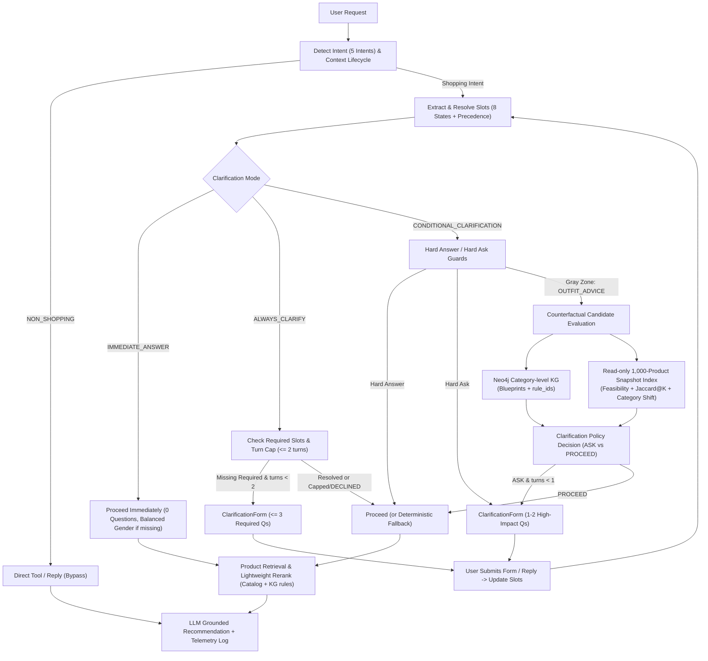

# SPEC v1.3 (SSOT) — Color-aware Category-level Outfit KG & Counterfactual Clarification Policy

- **Dự án:** `customer-shop-assistant`
- **Trạng thái:** Approved — Single Source of Truth (SSOT, nâng cấp từ v1.2)
- **Tài liệu liên quan:** [clarification_strategy_spec.md](file:///h:/Code/PET/customer-shop-assistant/docs/specs/clarification_strategy_spec.md) (quy ước chung về 5 intents, 3 modes, 8 slot states, `ClarificationForm`, Lifecycle, Fallback, Telemetry; đã hợp nhất toàn bộ quyết định từ bản đề xuất v1.1)
- **Hướng nghiên cứu:** **Hướng B — Clarification Policy sử dụng đồng thời Color-aware Category-level Fashion KG (Neo4j) và Fixed 1,000-Product Catalog Snapshot**
- **Ngôn ngữ:** Tiếng Việt

---

## 1. Mục tiêu & Ranh giới trách nhiệm

### 1.1 Câu hỏi nghiên cứu trung tâm

> Với một yêu cầu tư vấn/phối đồ chưa đầy đủ hoặc mơ hồ, việc hỏi làm rõ một context slot cụ thể có cải thiện đáng kể tính khả thi (feasibility), độ tuân thủ ràng buộc (constraint satisfaction) hoặc độ phù hợp của gợi ý đủ để bù đắp chi phí tương tác hay không?

Hệ thống **không** xây dựng ontology thời trang khổng lồ hay recommender production phức tạp, mà xây dựng **Category-level KG tối giản, sạch, có provenance (`rule_id`)** kết hợp **Fixed 1,000-Product Snapshot** để phục vụ nghiên cứu chiến lược hỏi làm rõ.

### 1.2 Ranh giới trách nhiệm từng thành phần

| Thành phần | Trách nhiệm chính | Cấm thực hiện |
|---|---|---|
| **Request Understanding & Slot Tracker** (`slot_tracker.py`) | Phân loại 5 intents; trích xuất/chuẩn hóa slot; quản lý 8 trạng thái slot, thứ tự ưu tiên nguồn và vòng đời 2 tầng | Tự quyết định hỏi mọi slot đang `UNKNOWN` |
| **Category-level Fashion KG (Neo4j)** | Lưu tri thức tương thích cấp danh mục (`Category`, `Style`, `Occasion`, `Color`); trả về `OutfitBlueprint`, `score_breakdown`, `applied_rule_ids`, `reasons` | Lưu node `Product`, `ProductVariant`, giá, tồn kho, hay node `ClarificationPolicy` / `Question` |
| **Fixed 1,000-Product Snapshot & Main BE** | Cung cấp tập sản phẩm cố định (`data/hm_seed_1000.json`, đồng bộ với PostgreSQL/Main BE) gồm `target_gender`, biến thể màu, giá bán, tồn kho; cung cấp **Read-only Snapshot Index** cho bước Counterfactual Probing nhanh (< 30 ms) | Nhân bản luật thời trang tổng quát thành thuộc tính rời rạc trên từng sản phẩm |
| **Clarification Policy & Form Planner** (`clarification_planner.py`) | Thực thi 3 mode chuẩn (`IMMEDIATE_ANSWER`, `ALWAYS_CLARIFY`, `CONDITIONAL_CLARIFICATION`); chạy **Counterfactual Evaluation** cho vùng xám của `OUTFIT_ADVICE`; tạo `ClarificationForm` hợp lệ | Bịa dữ kiện thời trang hoặc tự giả định tồn kho |
| **LLM** | Viết câu dẫn ngắn (`≤ 45 từ`) kèm Form khi hỏi; diễn giải bộ phối sản phẩm thật dựa trên `applied_rule_ids` và `reasons` từ KG | Ghi đè ràng buộc cứng, bịa `[ID]`/giá/tồn kho hoặc lặp danh sách câu hỏi vào text `reply` |

---

## 2. Kiến trúc tổng thể & Luồng xử lý



---

## 3. Fixed 1,000-Product Research Snapshot

### 3.1 Nguồn dữ liệu cố định

Đóng băng tập **`data/hm_seed_1000.json`** hiện có trong repository làm **Fixed Research Snapshot** (được sinh cùng manifest & coverage report qua script `scripts/build_snapshot_manifest.py`):

- **Tổng số sản phẩm:** `1,000` sản phẩm (`100%` có ít nhất 1 biến thể còn hàng; kiểm tra tồn kho ở mức biến thể màu/size).
- **Khoảng giá:** `144.000đ – 1.140.000đ`.
- **Phân bổ giới tính (`targetGender`):** `FEMALE: 575`, `MALE: 341`, `UNISEX: 84`.
- **Phân bổ 14 danh mục (`categoryName`):**
  - **9 danh mục Top-Bottom Blueprint (`740` sản phẩm):** `Áo thun` (100), `Áo sơ mi` (100), `Áo khoác` (95), `Quần jeans` (80), `Áo polo` (75), `Quần kaki` (75), `Quần âu` (75), `Chân váy` (75), `Quần short` (65).
  - **5 danh mục ngoài phạm vi Top-Bottom v1 (`260` sản phẩm):** `Váy liền` (95), `Đầm dạ hội` (70), `Túi xách` (35), `Mũ nón` (30), `Thắt lưng` (30).
- **Màu sắc:** đúng `33` màu chuẩn, khớp `33/33` với [colours.json](file:///h:/Code/PET/customer-shop-assistant/data/outfit_kg/ontology/colours.json) (0 màu chưa ánh xạ).

### 3.2 Chiến lược truy xuất hai tầng, Chuẩn hóa Màu & Runtime Catalog ↔ KG Mapping

1. **Counterfactual Probing (Bước đánh giá hỏi lại):** Dùng **`SnapshotCatalogIndex`** (chỉ mục read-only trong RAM nạp từ cùng snapshot `1,000` sản phẩm) để lọc theo `(category_id, target_gender, color_ids, min_price, max_price, in_stock)` → độ trễ **< 30 ms/lượt** thay vì bắn 15–30 HTTP semantic search sang Main BE, đồng thời đảm bảo kết quả thực nghiệm tái lập 100%.
2. **Product Retrieval cuối cùng:** Sử dụng cùng tập sản phẩm snapshot / Main BE (`ShopClient`) để lấy thông tin hiển thị thật (`product_id`, `name`, `slug`, `price`, `image_url`, `in_stock`).
3. **Color Normalization & Runtime Catalog ↔ KG Mapping (Bắt buộc):**
   - Mọi trường từ sản phẩm (`categoryName` → `category_id`, `variant.color` → `color_id`) và từ câu hỏi người dùng phải ánh xạ qua một nguồn chuẩn hóa duy nhất (`resolve_category_id`, `resolve_color_id`: strip khoảng trắng, chuẩn hóa Unicode/chữ thường, khớp `id` / `name` / `aliases`, có hỗ trợ strip dấu tiếng Việt).
   - **Offline pre-seed validator (`scripts/build_snapshot_manifest.py`, `scripts/seed_neo4j_kg.py`):** **Fail-fast** — bất kỳ `categoryName` hoặc `color` nào của `hm_seed_1000.json` không ánh xạ được đều báo `unmapped` và chặn seed.
   - **Runtime (live Main BE / truy vấn mở):** Tuyệt đối không tự tạo node KG mới lúc chạy. Nếu live Main BE phát sinh tên màu lạ chưa có trong 33 canonical colors, hệ thống **degrade gracefully**: ghi nhận vào `color_score_breakdown.unmapped_colors`, áp điểm fallback trung tính `0.50` và vẫn giữ sản phẩm hợp lệ trong kết quả.
   - **Không triển khai `(:Category)-[:HAS_COLOR]->(:Color)`** và **tiếp tục Zero Product Nodes**: tập màu đang còn hàng của từng danh mục được suy động ở Runtime Catalog / `SnapshotCatalogIndex`, không sao chép vào Neo4j.

---

## 4. Đặc tả Category-level Fashion KG (Neo4j)

### 4.1 Phạm vi Node Types (Đúng 4 Core Nodes — Zero Product Nodes)

> [!IMPORTANT]
> Chỉ kích hoạt **4 loại node cốt lõi** cho v1.3: `Category`, `Style`, `Occasion`, `Color` (giữ nguyên **33** `Color` nodes, tiếp tục **Zero Product / ProductVariant Nodes**).
> Các node `Pattern`, `Season`, `BodyType`, `Fit` đều **hoãn (DEFERRED)** để giữ KG sạch, đúng trọng tâm nghiên cứu Clarification Policy.

#### 1. `(:Category)`
| Property | Type | Quy ước |
|---|---|---|
| `id` | `string` (UNIQUE) | Canonical slug không dấu: `ao_thun`, `ao_polo`, `ao_so_mi`, `ao_khoac`, `quan_jeans`, `quan_kaki`, `quan_short`, `quan_au`, `chan_vay` |
| `name` | `string` | Tên chuẩn khớp Main BE `Category.name`: `"Áo sơ mi"`, `"Quần kaki"` |
| `aliases` | `list[string]` | Từ đồng nghĩa chuẩn hóa, đồng bộ với `slot_tracker.py` |
| `role` | `string` | `TOP`, `OUTERWEAR`, `BOTTOM`, `ONE_PIECE`, `ACCESSORY` |
| `base_formality` | `int (1..5)` | **Soft prior** tham khảo, **không** dùng làm hard filter |
| `supports_top_bottom_blueprint` | `bool` | `true` cho 9 danh mục Top/Outerwear/Bottom (740 SP); `false` cho 5 danh mục đầm/phụ kiện (260 SP) |

*Lưu ý quan trọng:* **Không** đặt `allowed_genders` làm bộ lọc cứng trên `(:Category)`. Việc lọc giới tính (`target_gender`) thực hiện trên bản ghi sản phẩm của Product Catalog.

#### 2. `(:Style)`
| Property | Type | Quy ước |
|---|---|---|
| `id` | `string` (UNIQUE) | 6 style cốt lõi: `smart_casual`, `formal_office`, `casual`, `minimalist`, `streetwear`, `elegant` |
| `name` | `string` | `"Smart Casual"`, `"Lịch sự công sở"`, `"Casual"`, `"Minimalist"`, `"Streetwear"`, `"Thanh lịch"` |
| `aliases` | `list[string]` | Đồng bộ với `_extract_style()` trong `slot_tracker.py` |
| `formality_min` / `formality_max` | `int (1..5)` | Soft prior (tùy chọn) |
| `description` | `string` | Mô tả ngắn hỗ trợ giải thích |

#### 3. `(:Occasion)`
| Property | Type | Quy ước |
|---|---|---|
| `id` | `string` (UNIQUE) | 8 dịp cốt lõi: `office`, `meeting`, `party`, `date`, `cafe`, `hangout`, `travel_beach`, `sport` |
| `name` | `string` | `"Công sở / Đi làm"`, `"Gặp khách / Đi họp"`, `"Dự tiệc / Đám cưới"`, `"Hẹn hò"`, `"Cà phê"`, `"Đi chơi / Dạo phố"`, `"Du lịch / Đi biển"`, `"Thể thao / Vận động"` |
| `slot_code` | `string` | Khớp 1-1 với `_extract_occasion()` trong `slot_tracker.py` (`office`, `party`, `casual`, `sport`) |
| `aliases` | `list[string]` | Kiểm tra không trùng lặp alias trước khi seed |
| `formality_min` / `formality_max` | `int (1..5)` | Soft prior (tùy chọn) |

#### 4. `(:Color)`
| Property | Type | Quy ước |
|---|---|---|
| `id` | `string` (UNIQUE) | 33 canonical slug khớp 33/33 màu của `hm_seed_1000.json` (vd `xanh_navy`, `be_sua`, `trang`, `den`) |
| `name` | `string` | Tên chuẩn khớp `ProductVariant.color`: `"Xanh navy"`, `"Be sữa"` |
| `aliases` | `list[string]` | Đồng bộ với `_extract_color()` trong `slot_tracker.py` |
| `family` | `string` | `black`, `white`, `grey`, `beige`, `brown`, `blue`, `teal`, `green`, `pink`, `red`, `orange`, `yellow`, `purple` |
| `neutral` | `bool` | Màu trung tính hay không |
| `lightness` | `string` | `light`, `mid`, `dark` |

---

### 4.2 Phạm vi Relationship Types (Đúng 7 Core Relationships)

> [!NOTE]
> Bỏ `CONFLICTS_WITH` (hard exclusion), bỏ `CLASHES_WITH` tự sinh theo `loud`, **không triển khai `(:Category)-[:HAS_COLOR]->(:Color)`**, hoãn `LAYERS_OVER` và `PREFERS_FIT`. Mọi cạnh đều mang provenance chuẩn (`rule_id`, `compatibility`, `confidence`, `reason`, `source`).

| # | Relationship Pattern | Thuộc tính bắt buộc | Ngữ nghĩa & Quy tắc sử dụng |
|---|---|---|---|
| 1 | `(:Occasion)-[:FITS_STYLE]->(:Style)` | `rule_id`, `compatibility`, `confidence`, `is_default`, `reason`, `source` | Liên kết dịp mặc với các phong cách phù hợp (VD: `office -> smart_casual`, `formal_office`). |
| 2 | `(:Occasion)-[:SUITS_CATEGORY]->(:Category)` | `rule_id`, `compatibility`, `confidence`, `reason`, `source` | **Phương án A (Exclusive Branching):** Chỉ dẫn trực tiếp danh mục cho dịp mặc. **Chỉ dùng khi `style` chưa xác định (`UNKNOWN`/`DECLINED`)**, cấm cộng trùng với `RECOMMENDS_CATEGORY`. |
| 3 | `(:Style)-[:RECOMMENDS_CATEGORY]->(:Category)` | `rule_id`, `compatibility`, `confidence`, `reason`, `source` | Danh mục đặc trưng của phong cách. **Chỉ dùng khi `style` đã được xác định.** |
| 4 | `(:Category)-[:PAIRS_WITH]->(:Category)` | `rule_id`, `compatibility`, `confidence`, `style_ids`, `occasion_ids`, `reason`, `source` | Cạnh phối đồ cốt lõi. Lưu 1 chiều chuẩn `TOP/OUTERWEAR -> BOTTOM`. Truy vấn Mode A duyệt hai chiều nhưng chuẩn hóa lại vai trò `top`/`bottom`. `compatibility` là tín hiệu xếp hạng (không phải xác suất). |
| 5 | `(:Color)-[:HARMONIZES_WITH]->(:Color)` | `rule_id`, `kind`, `compatibility`, `confidence`, `reason`, `source` | Cặp màu hài hòa chuẩn hóa đúng **4 loại `kind`**: `classic_contrast`, `monochrome_tone`, `neutral_balance`, `analogous_soft`. Lưu 1 chiều chuẩn (`c1.id < c2.id`), truy vấn vô hướng, phủ đủ **33/33** node màu (0 màu cô lập). |
| 6 | `(:Style)-[:PREFERS_COLOR]->(:Color)` | `rule_id`, `compatibility`, `confidence`, `reason`, `source` | **Bắt buộc triển khai cho đủ 6 `Style`:** Xác định bảng màu đặc trưng của từng phong cách (VD: `minimalist -> den, trang, trang_kem, be_sua, xam_*`; `streetwear -> den, trang, xanh_reu_khaki, do_tuoi, cam...`). |
| 7 | `(:Occasion)-[:SUITS_COLOR]->(:Color)` | `rule_id`, `compatibility`, `confidence`, `reason`, `source` | **Bổ sung có chọn lọc:** Chỉ gắn cho các dịp có bản sắc màu rõ (`office`, `meeting`, `party`, `date`, `travel_beach`, `sport`); không rải đều cho mọi dịp như `hangout`/`cafe`. |

#### Bảng tổng hợp nhanh theo từng Node

| Node | Outgoing (`->`) | Incoming (`<-`) |
|---|---|---|
| `:Occasion` | `FITS_STYLE -> :Style`, `SUITS_CATEGORY -> :Category`, `SUITS_COLOR -> :Color` *(chọn lọc)* | *(Entry node)* |
| `:Style` | `RECOMMENDS_CATEGORY -> :Category`, `PREFERS_COLOR -> :Color` | `FITS_STYLE <- :Occasion` |
| `:Category` | `PAIRS_WITH -> :Category` | `SUITS_CATEGORY <- :Occasion`, `RECOMMENDS_CATEGORY <- :Style`, `PAIRS_WITH <- :Category` |
| `:Color` | `HARMONIZES_WITH -> :Color` *(undirected query)* | `HARMONIZES_WITH <- :Color`, `PREFERS_COLOR <- :Style`, `SUITS_COLOR <- :Occasion` |

---

### 4.3 Neo4j Constraints & Quy tắc Scoring không đếm trùng (Phương án A)

#### Constraints
```cypher
CREATE CONSTRAINT category_id IF NOT EXISTS FOR (n:Category) REQUIRE n.id IS UNIQUE;
CREATE CONSTRAINT style_id    IF NOT EXISTS FOR (n:Style)    REQUIRE n.id IS UNIQUE;
CREATE CONSTRAINT occasion_id IF NOT EXISTS FOR (n:Occasion) REQUIRE n.id IS UNIQUE;
CREATE CONSTRAINT color_id    IF NOT EXISTS FOR (n:Color)    REQUIRE n.id IS UNIQUE;
```

#### Quy tắc phân nhánh Scoring loại trừ (Zero Double-Counting)
Mọi truy vấn đều khớp theo **canonical `id`** (không khớp `name`) và **không lọc cứng `abs(base_formality diff) <= 2`**:

1. **Nhánh 1 — Đã biết `style_id` (có hoặc không có `occasion_id`)**:
   - Dùng `Style -[:RECOMMENDS_CATEGORY]-> Category` + `Category -[:PAIRS_WITH]-> Category` (+ `Occasion -[:FITS_STYLE]-> Style` nếu có `occasion_id`).
   - **Không truy vấn `SUITS_CATEGORY`.**
   - Công thức xếp hạng khởi đầu (tinh chỉnh trên tập dev rồi đóng băng):
     - `score = 0.45 * pair.compatibility + 0.25 * st_top.compatibility + 0.25 * st_bot.compatibility + 0.05 * coalesce(occ_style.compatibility, 0.5)`
2. **Nhánh 2 — Chưa biết `style_id`, đã biết `occasion_id`**:
   - Dùng `Occasion -[:SUITS_CATEGORY]-> Category` + `Category -[:PAIRS_WITH]-> Category`.
   - **Không cộng điểm từ `RECOMMENDS_CATEGORY`.**
   - Công thức xếp hạng khởi đầu:
     - `score = 0.50 * pair.compatibility + 0.25 * occ_top.compatibility + 0.25 * occ_bot.compatibility`
3. **Nhánh 3 — Cả `style_id` và `occasion_id` đều chưa biết (vd Mode A thuần anchor hoặc Fallback)**:
   - Dùng trực tiếp `Category -[:PAIRS_WITH]-> Category`: `score = pair.compatibility`.
4. **Tầng Màu sắc (`Context Color Palette` + `Pair Harmony` — Tách bước / `OPTIONAL MATCH`)**:
   - **Context Palette (`PREFERS_COLOR` + `SUITS_COLOR`) — Trộn chuẩn hóa 70/30 (không inflate điểm):**
     - Chỉ có `style_id` (hoặc `occasion_id` không có cạnh `SUITS_COLOR`): `context_fit(c) = 1.0 * style_color(c)`.
     - Chỉ có `occasion_id` (có `SUITS_COLOR`): `context_fit(c) = 1.0 * occasion_color(c)`.
     - Có **cả** `style_id` và `occasion_id` (đều có cạnh màu): `context_fit(c) = 0.70 * style_color(c) + 0.30 * occasion_color(c)`.
     - Màu không nằm trong cạnh nào: fallback `0.65` nếu `c.neutral = true`, `0.50` cho màu thường (hoặc `0.50` nếu gặp màu lạ `unmapped` lúc runtime).
   - **Pair Harmony (`HARMONIZES_WITH`)**:
     - Truy vấn trực tiếp `(:Color {id: top_color_id})-[h:HARMONIZES_WITH]-(:Color {id: bottom_color_id})` cho **mọi** cặp áo–quần (kể cả khi khách **không** nêu màu neo).
     - Nếu có cạnh → lấy `h.compatibility` và `h.kind`; nếu cùng màu trung tính (`top == bottom` & `neutral=true`) → `0.80` (`monochrome_tone`); nếu 1 trong 2 là `neutral=true` → `0.65`; nếu không có cạnh nối → `0.45`; nếu màu `unmapped` runtime → `0.50`.

#### 4.4 Color-aware Outfit Scoring & Debug Breakdown (Bắt buộc)

Tại `OutfitRetrievalAndReranker`, điểm xếp hạng cuối cùng của mỗi bộ phối kết hợp tường minh tầng Category và tầng Màu sắc:

$$\text{final\_score} = 0.70 \times \text{blueprint\_score} + 0.30 \times \text{color\_score}$$

Trong đó `color_score ∈ [0, 1]` được cấu thành rõ ràng để ghi vào **`ColorScoreBreakdown`** phục vụ debug:

- **Khi khách KHÔNG nêu màu (`user_color_match = None`):**
  $$\text{color\_score} = 0.50 \times \text{pair\_harmony} + 0.50 \times \text{context\_color\_fit}$$
- **Khi khách CÓ nêu màu (`color` / `top_color` / `bottom_color` / `favorite_colors`):**
  $$\text{color\_score} = 0.40 \times \text{pair\_harmony} + 0.25 \times \text{context\_color\_fit} + 0.35 \times \text{user\_color\_match}$$
  - `context_color_fit = 0.5 * (context_fit(top_color) + context_fit(bottom_color))`.
  - `disliked_colors` vẫn luôn là **hard filter** loại trước bước chấm điểm.
- Mọi `OutfitSuggestion` trả về **bắt buộc** đính kèm `blueprint_score` và `color_score_breakdown` (`ColorScoreBreakdown`) gồm đủ các điểm thành phần, `harmony_kind`, `top_color_id`, `bottom_color_id`, `color_rule_ids` và `unmapped_colors`.

#### Cypher mẫu — Truy vấn Context Color Palette (`Style + Occasion`)
```cypher
OPTIONAL MATCH (s:Style {id: $style_id})-[sp:PREFERS_COLOR]->(c1:Color)
WITH collect(CASE WHEN c1 IS NOT NULL THEN {
  color_id: c1.id, compatibility: sp.compatibility, rule_id: sp.rule_id, reason: sp.reason
} END) AS style_colors
OPTIONAL MATCH (o:Occasion {id: $occasion_id})-[oc:SUITS_COLOR]->(c2:Color)
RETURN [x IN style_colors WHERE x IS NOT NULL] AS style_colors,
       [x IN collect(CASE WHEN c2 IS NOT NULL THEN {
         color_id: c2.id, compatibility: oc.compatibility, rule_id: oc.rule_id, reason: oc.reason
       } END) WHERE x IS NOT NULL] AS occasion_colors;
```

#### Cypher mẫu — Nhánh 1 (`Smart Casual + Office`, Mode B)
```cypher
MATCH (s:Style {id: $style_id})-[st:RECOMMENDS_CATEGORY]->(top:Category)
WHERE top.role = "TOP" AND top.supports_top_bottom_blueprint = true
MATCH (s)-[sb:RECOMMENDS_CATEGORY]->(bot:Category)
WHERE bot.role = "BOTTOM" AND bot.supports_top_bottom_blueprint = true
MATCH (top)-[p:PAIRS_WITH]->(bot)
OPTIONAL MATCH (o:Occasion {id: $occasion_id})-[os:FITS_STYLE]->(s)
WITH top, bot, p, st, sb, os,
     coalesce(os.compatibility, 0.5) AS occ_style_score
WITH top, bot, p, st, sb, os, occ_style_score,
     (0.45 * p.compatibility
      + 0.25 * st.compatibility
      + 0.25 * sb.compatibility
      + 0.05 * occ_style_score) AS total_score
ORDER BY total_score DESC
LIMIT $limit
RETURN top.id AS top_category_id,
       bot.id AS bottom_category_id,
       round(total_score, 4) AS score,
       {
         pair: p.compatibility,
         style_top: st.compatibility,
         style_bottom: sb.compatibility,
         occasion_style: occ_style_score
       } AS score_breakdown,
       [x IN [p.rule_id, st.rule_id, sb.rule_id, os.rule_id] WHERE x IS NOT NULL] AS applied_rule_ids,
       [x IN [p.reason, st.reason, sb.reason, os.reason] WHERE x IS NOT NULL] AS reasons;
```

---

## 5. Hợp nhất Slot Model & 3 Clarification Modes (Quy ước chung)

Kế thừa trọn vẹn quy ước của [clarification_strategy_spec.md](file:///h:/Code/PET/customer-shop-assistant/docs/specs/clarification_strategy_spec.md) để toàn dự án chỉ có **một hệ thuật ngữ duy nhất**.

### 5.1 Tám trạng thái Slot & Vòng đời Ngữ cảnh

- **8 trạng thái chuẩn:** `PROVIDED`, `RESOLVED_FROM_CONTEXT`, `INFERRED` *(kèm `confidence: high | low`)*, `UNKNOWN`, `AMBIGUOUS`, `CONFLICTING`, `DECLINED`, `NOT_APPLICABLE`.
- **Thứ tự ưu tiên nguồn:** `Current Explicit (PROVIDED) > History Explicit (RESOLVED_FROM_CONTEXT) > User Profile (RESOLVED_FROM_CONTEXT) > High-Confidence Inferred (INFERRED)`.
- **Vòng đời 2 tầng:**
  - *Session-persistent:* `target_gender`, `measurements`, `body_concern`, `fit`, `size`.
  - *Task-scoped:* `category`, `category_subtype`, `top_category`, `bottom_category`, `product_id`, `occasion`, `budget`, `style`, `color`, `top_color`, `bottom_color`, `disliked_colors`, `material`.

### 5.2 Ma trận Slot cho `OUTFIT_ADVICE` (trong thí nghiệm KG + Clarification)

| Nhóm | Slots | Vai trò trong Counterfactual & Retrieval |
|---|---|---|
| **Required Slots** | `target_gender`, và **≥ 1 điểm neo ngữ cảnh** (`occasion` HOẶC `top_category` / `bottom_category` / `product_id`) | Kiểm tra ở `ALWAYS_CLARIFY` và Guard của `CONDITIONAL_CLARIFICATION` |
| **Conditional Slots** *(eligible cho Counterfactual)* | `occasion` *(khi đã có item neo)*, `style`, `budget`, `top_category` / `bottom_category`, `color` / `top_color` / `bottom_color` | Đánh giá tác động từng slot một trong vùng xám của `CONDITIONAL_CLARIFICATION` |
| **Hard Constraints vs. Soft Preferences** | **Hard:** `budget` (nếu nêu), `disliked_colors`, `product_id`/món neo, `target_gender` (nếu nêu)<br>**Soft:** `style`, `preferred_colors`, `base_formality` | Hard phải được thỏa mãn ở Retrieval; Soft chỉ dùng để xếp hạng & đo tác động |
| **Optional / Out-of-scope v1** | `fit`, `material`, `size`, `pattern`, `season`, `body_concern`, `measurements` | Không tự động hỏi trong thí nghiệm Outfit Clarification v1 |

### 5.3 Hành vi chuẩn của 3 Clarification Modes (theo `clarification_strategy_spec.md`)

Tất cả 3 mode dùng chung **cùng LLM, cùng Neo4j KG snapshot, cùng Fixed 1,000-Product Snapshot, cùng retrieval/reranking** — chỉ thay đổi chiến lược hỏi lại:

| Tiêu chí | `IMMEDIATE_ANSWER` | `ALWAYS_CLARIFY` | `CONDITIONAL_CLARIFICATION` |
|---|---|---|---|
| **NON_SHOPPING** | Bypass | Bypass | Bypass |
| **Điều kiện hỏi** | **Không bao giờ hỏi** (strict `0`) | Còn **Required Slot** chưa giải quyết (`UNKNOWN`/`AMBIGUOUS`/`CONFLICTING`) | **Hybrid:** Hard Answer Guard / Hard Ask Guard → **Gray Zone dùng Counterfactual Evaluation (Neo4j KG + 1,000-Product Snapshot Index)** |
| **Đủ Required Slots ở lượt 1** | Trả lời ngay | Trả lời ngay (không hỏi Optional) | Trả lời ngay (trừ khi có `CONFLICTING` hoặc unfulfillable hard constraint) |
| **Số câu hỏi / 1 `ClarificationForm`** | `0` | Tối đa **3 câu** (chỉ Required Slots thiếu) | Tối đa **1–2 câu** (slot có điểm tác động counterfactual cao nhất) |
| **Số lượt hỏi tối đa / 1 yêu cầu** | `0` | Tối đa **2 lượt** (sau đó Fallback) | Tối đa **1 lượt** (`+1` lượt chỉ khi phát sinh `CONFLICTING`) |
| **Văn bản dẫn nhập (`reply`)** | Trả lời trực tiếp | `≤ 45 từ`, không lặp options/câu hỏi | `≤ 45 từ`, không lặp options/câu hỏi |
| **Xử lý `DECLINED` / vượt trần** | N/A | Áp dụng **Fallback tất định** (Balanced Multi-Gender, casual/smart-casual default) | Áp dụng **Fallback tất định** |
| **Bằng chứng log (`logs/chat_turns.jsonl`)** | `mode_a_immediate` | Danh sách Required Slots thiếu/đủ | `reason_codes` + `impact_signals` + `evidence_rule_ids` từ KG & Snapshot |

---

## 6. Counterfactual Clarification Policy (Cho vùng xám của `OUTFIT_ADVICE`)

### 6.1 Quy trình đánh giá từng slot (`Single-Slot Counterfactual`)

Với mỗi slot `s` đủ điều kiện đang ở trạng thái `UNKNOWN` hoặc `AMBIGUOUS` (đánh giá **từng slot độc lập**, không tổ hợp tích Descartes giữa nhiều slot):

1. **Sinh tập ứng viên `V_s`** nhỏ, hợp lý từ ontology KG và snapshot 1,000 sản phẩm (giữ cố định toàn bộ slot đã biết):
   - VD `target_gender`: `["MALE", "FEMALE"]`
   - VD `occasion`: `["office", "hangout", "party"]` (hoặc các dịp khớp với item neo)
   - VD `style`: các style nối với `occasion` qua `FITS_STYLE` (hoặc top 3–4 style phổ biến)
   - VD `budget`: các phân khúc giá thực tế của snapshot (`<= 300k`, `300k–600k`, `> 600k`) — chỉ xét khi người dùng nhắc đến ngân sách mơ hồ hoặc tập sản phẩm quá rộng/phân hóa mạnh.
   - VD `color` *(chỉ kích hoạt theo Mục 6.2 — không mặc định probe)*: các nhóm tông màu đại diện khả thi trong catalog (`neutral_classic`, `earth_warm`, `bright_accent`).
2. **Chạy Counterfactual Probe** cho mỗi `v ∈ V_s`:
   - Query `OutfitKGRepository` (Neo4j / InMemory) → lấy `OutfitBlueprint`, `ContextColorPalette`, `HARMONIZES_WITH` + `applied_rule_ids`.
   - Query `SnapshotCatalogIndex` (in-memory < 30 ms) → lấy số sản phẩm khả thi, số bộ phối khả thi, Top-K outfit/product IDs, tập `category_ids` và `mean_color_score`.
3. **Tính các tín hiệu tác động (`impact_signals`)** giữa các ứng viên `v_i, v_j ∈ V_s`:
   - `feasibility_change: bool` — có ứng viên nào dẫn đến 0 kết quả / thiếu hụt sản phẩm nghiêm trọng không.
   - `category_shift: bool` — cặp Category đứng đầu thay đổi đáng kể giữa các ứng viên hay không.
   - `mean_top_k_jaccard: float` — trung bình `Jaccard@K(A, B) = |A ∩ B| / |A ∪ B|` giữa các cặp ứng viên (càng thấp → độ nhạy càng cao).
   - `color_quality_gain: float` — mức cải thiện `max(mean_color_score(v)) - baseline_mean_color_score` khi thăm dò slot `color`.
4. **Thứ tự quyết định (`Decision Order`)**:
   1. **Giải quyết `CONFLICTING` hoặc ràng buộc cứng không khả thi** (bao gồm màu yêu cầu không còn hàng hoặc mâu thuẫn `disliked_colors`) → `ASK` ngay.
   2. **Kiểm tra Feasibility** → nếu chọn sai giả định làm kết quả rỗng/sai nhiệm vụ → `ASK`.
   3. **Kiểm tra độ nhạy kết quả (`category_shift` + `mean_top_k_jaccard` + `color_quality_gain`)**.
   4. **Kiểm tra khả năng bao phủ bằng đa dạng phương án (`Alternatives Check`)**: nếu các ứng viên đều khả thi và có thể trình bày 2–3 phương án đại diện gọn gàng (VD *"Phối áo sơ mi trắng với quần gì?"* đã có item neo rõ → chia phương án Nam & Nữ; hoặc 2–3 bộ phối đa dạng tông màu từ `Style`/`Occasion`) → ưu tiên **`PROCEED`** thay vì hỏi.
   5. **Chi phí tương tác**: nếu cần `ASK`, xếp hạng slot theo tác động giảm dần và chọn **1–2 slot tác động cao nhất** để đưa vào 1 `ClarificationForm` (tuân thủ giới hạn `1` lượt hỏi của `CONDITIONAL_CLARIFICATION`).

### 6.2 Chính sách Hỏi lại cho `color` (Color-aware Clarification — Không mặc định hỏi màu)

> [!IMPORTANT]
> Khi người dùng **chưa nêu màu yêu thích**, Policy **tuyệt đối không mặc định hỏi màu**. Hệ thống trước hết phải dùng `Style` (`PREFERS_COLOR`), `Occasion` (`SUITS_COLOR`), `HARMONIZES_WITH` và `Catalog` để suy ra các bảng màu khả thi.

Slot `color` chỉ được phép kích hoạt `ASK` trong đúng **3 điều kiện có kiểm chứng**:
1. **Điều kiện A — Ràng buộc màu không khả thi / mâu thuẫn (`UNFULFILLABLE_COLOR_CONSTRAINT` / `CONFLICTING`):**
   - Khách nêu màu cụ thể nhưng catalog không có biến thể còn hàng phù hợp hoặc mâu thuẫn trực tiếp với `disliked_colors` → `ASK` xác nhận đổi màu / nới lỏng ràng buộc màu.
2. **Điều kiện B — Sở thích màu mơ hồ tường minh (`AMBIGUOUS_COLOR_PREFERENCE`):**
   - Khách chủ động bày tỏ phân vân về màu (VD *"nên chọn màu sáng hay màu tối?"*, *"màu nào nổi bật mà vẫn lịch sự?"*) → chạy counterfactual probe các nhóm tông màu ứng viên (`neutral_classic`, `earth_warm`, `bright_accent`); chỉ `ASK` nếu lựa chọn tông màu thực sự làm phân tách rõ kết quả và không phủ gọn được trong 2–3 bộ phối.
3. **Điều kiện C — Khoảng trống chất lượng / tính khả thi màu (`LOW_BASELINE_COLOR_QUALITY`):**
   - Các slot chính (`target_gender`, `occasion` hoặc item anchor) đều đã rõ và không còn slot nào khác có tác động cao hơn, **nhưng** bảng màu mặc định cho tổ hợp đó có chất lượng màu dưới ngưỡng (`baseline_mean_color_score < min_color_quality`), **đồng thời** việc chọn một nhóm tông màu cụ thể đem lại `feasibility_change = true` hoặc `color_quality_gain >= color_gain_threshold` (được hiệu chỉnh trên tập Dev và đóng băng trước Test) mà không thể bao phủ gọn bằng 2–3 phương án đại diện.

> [!IMPORTANT]
> Không đặt cứng các ngưỡng số cuối cùng (`jaccard_threshold`, `min_viable_outfits`, `min_color_quality`, `color_gain_threshold`) bằng cảm tính trước khi chạy pilot. Toàn bộ ngưỡng được hiệu chỉnh trên **tập Development**, sau đó **đóng băng (freeze)** trước khi chạy bộ Test chính thức.

---

## 7. Hợp đồng dữ liệu & Ranh giới Module

### 7.1 Kiến trúc Module

```text
slot_tracker.py (RequestUnderstanding + 8-State SlotTracker)
  -> CandidateValueBuilder
  -> OutfitKGRepository (Protocol)
       ├── Neo4jOutfitKGRepository       (runtime & visual debug trên Neo4j Browser)
       └── InMemoryOutfitKGRepository    (unit test pytest & offline eval không cần Docker)
  -> SnapshotCatalogIndex                (read-only index từ data/hm_seed_1000.json, < 30ms)
  -> CounterfactualClarificationPolicy   (trả ClarificationDecision + impact_signals)
  -> clarification_planner.py            (tạo ClarificationForm tuân thủ spec chung)
  -> OutfitRetrievalAndReranker          (ghép sản phẩm thật + chấm điểm mềm màu sắc)
  -> agent_service.py / LLM              (diễn giải grounded + ghi Telemetry)
```

### 7.2 Pydantic Data Contracts (Tối giản, đúng những trường được tính)

```python
from typing import Any, Literal
from pydantic import BaseModel, Field

SlotStatus = Literal[
    "PROVIDED",
    "RESOLVED_FROM_CONTEXT",
    "INFERRED",
    "UNKNOWN",
    "AMBIGUOUS",
    "CONFLICTING",
    "DECLINED",
    "NOT_APPLICABLE",
]

ColorHarmonyKind = Literal[
    "classic_contrast",
    "monochrome_tone",
    "neutral_balance",
    "analogous_soft",
]


class OutfitBlueprint(BaseModel):
    top_category_id: str
    bottom_category_id: str
    score: float
    score_breakdown: dict[str, float] = Field(default_factory=dict)
    reasons: list[str] = Field(default_factory=list)
    applied_rule_ids: list[str] = Field(default_factory=list)


class ColorHarmonyAdvice(BaseModel):
    anchor_color_id: str
    recommended_color_ids: list[str] = Field(default_factory=list)
    compatibility_by_color: dict[str, float] = Field(default_factory=dict)
    kind_by_color: dict[str, ColorHarmonyKind] = Field(default_factory=dict)
    rule_id_by_color: dict[str, str] = Field(default_factory=dict)
    applied_rule_ids: list[str] = Field(default_factory=list)
    reasons: list[str] = Field(default_factory=list)
    available: bool = True


class ContextColorPalette(BaseModel):
    style_id: str | None = None
    occasion_id: str | None = None
    scores_by_color: dict[str, float] = Field(default_factory=dict)
    style_scores_by_color: dict[str, float] = Field(default_factory=dict)
    occasion_scores_by_color: dict[str, float] = Field(default_factory=dict)
    rule_ids_by_color: dict[str, list[str]] = Field(default_factory=dict)
    reasons_by_color: dict[str, list[str]] = Field(default_factory=dict)


class ColorScoreBreakdown(BaseModel):
    color_score: float = Field(..., ge=0.0, le=1.0)
    pair_harmony: float = Field(..., ge=0.0, le=1.0)
    harmony_kind: ColorHarmonyKind | None = None
    context_color_fit: float = Field(..., ge=0.0, le=1.0)
    style_color_fit: float | None = None
    occasion_color_fit: float | None = None
    user_color_match: float | None = None
    top_color_id: str | None = None
    bottom_color_id: str | None = None
    color_rule_ids: list[str] = Field(default_factory=list)
    unmapped_colors: list[str] = Field(default_factory=list)


class CandidateOutcome(BaseModel):
    candidate_value: Any
    feasible_product_count: int
    feasible_blueprint_count: int
    top_k_ids: list[str] = Field(default_factory=list)
    category_pairs: list[tuple[str, str]] = Field(default_factory=list)
    applied_rule_ids: list[str] = Field(default_factory=list)
    mean_color_score: float = 0.0


class SlotImpactSignals(BaseModel):
    feasibility_change: bool
    category_shift: bool
    mean_top_k_jaccard: float = Field(..., ge=0.0, le=1.0)
    can_cover_with_alternatives: bool
    color_quality_gain: float = 0.0


class ClarificationDecision(BaseModel):
    action: Literal["ASK", "PROCEED"]
    target_slots: list[str] = Field(
        default_factory=list
    )  # 1-2 slots theo mode C, <=3 theo mode B
    reason_codes: list[str] = Field(default_factory=list)
    impact_signals: dict[str, SlotImpactSignals] = Field(default_factory=dict)
    evidence_rule_ids: list[str] = Field(default_factory=list)
    question_intent: str | None = None
```

---

## 8. Quản trị dữ liệu, Neo4j & Kiểm thử

1. **Source of Truth trong Git (`data/outfit_kg/ontology/`):**
   - `categories.json`, `styles.json`, `occasions.json`, `colours.json`, `edges.json`.
   - Mọi chỉnh sửa tri thức đều review qua Git diff, không sửa tay rời rạc trong Neo4j.
2. **Pre-seed Validator & Idempotent Seeder (`scripts/seed_neo4j_kg.py`):**
   - Trước khi nạp vào Neo4j, bắt buộc chạy validator kiểm tra: trùng `id`, trùng `alias`, cạnh trỏ tới `id` không tồn tại, `categoryName` / `color` trong `hm_seed_1000.json` bị `unmapped`, `slot_code` lệch với `slot_tracker.py`, đủ 6 `Style` có cạnh `PREFERS_COLOR`, `HARMONIZES_WITH.kind` thuộc đúng 4 loại chuẩn và **33/33** node `Color` không có màu cô lập.
   - Hỗ trợ `--reset` để làm sạch và nạp lại idempotent bằng `MERGE`.
3. **Neo4j Local Service (`H:\Code\PET\e-commerce-clothes\docker-compose.yml`):**
   - Dùng `neo4j:5-community` (cổng `7474` Neo4j Browser để trực quan hóa/debug, cổng `7687` Bolt), đặt chung trong `docker-compose.yml` của backend.
   - Chạy bằng `docker-compose up -d neo4j` (theo quy tắc dự án).
4. **Repository Pattern cho Testing:**
   - `uv run pytest` mặc định dùng `InMemoryOutfitKGRepository` (đọc cùng thư mục `ontology/`) → chạy nhanh, xanh 100% không phụ thuộc container Neo4j.
   - Bổ sung integration test có điều kiện (chỉ chạy khi Neo4j đang bật) để xác minh kết quả giữa `Neo4jOutfitKGRepository` và `InMemoryOutfitKGRepository` khớp nhau 100% (bao gồm cả `get_context_color_palette` và `get_color_harmony`).

---

## 9. Khung Đánh giá Thực nghiệm (E1 v1.3 — Hợp nhất 2 tầng)

Thực hiện trên **84 kịch bản có kiểm soát** (**28 Dev** để chỉnh & đóng băng ngưỡng / **56 Frozen Test** để đánh giá cuối cùng), bao gồm 72 kịch bản lõi (`OPEN`, `ANCHOR`, `PRODUCT_SEARCH`, `SIZE_ADVICE`, `BODY_FIT_ADVICE`, `NON_SHOPPING`) + **12 kịch bản chuyên biệt về màu sắc** (4 Dev / 8 Test: không nêu màu có Style/Occasion rõ → `proceed`, phân vân tông màu mơ hồ, và màu yêu cầu không khả thi / xung đột `disliked_colors` → `must_clarify`), gắn nhãn gold kèm rationale độc lập.

- **So sánh chính:** `IMMEDIATE_ANSWER` vs. `ALWAYS_CLARIFY` vs. `CONDITIONAL_CLARIFICATION` (Color-aware KG + Snapshot Counterfactual).
- **Ablation:** Conditional với *Catalog-only* vs. *KG-only* vs. *KG + Catalog* (và đối chiếu chất lượng màu v1.2 vs v1.3).
- **Chỉ số đo lường (khớp `clarification_strategy_spec.md` Mục 10 + v1.1 Mục 11.4):**
  - *Tầng 1 (Automated):* `Clarification Rate`, `Clarification Question Count` (số câu/yêu cầu), `Turns to Completion`, `Clarification Policy Compliance`, `Constraint Satisfaction Rate`, `Catalog Grounding / Rule Violation Rate`, **`Mean Color Score`**, **`Color Harmony Rate`**, `Response Latency (ms)`, `Token Usage`.
  - *Tầng 2 (Human / LLM-as-a-Judge):* `Recommendation Relevance (1–5)`, `Unnecessary Question Rate`, `Missed Necessary Clarification Rate`, `Task Completion Rate`, `Explanation Faithfulness` (đối chiếu với `applied_rule_ids` + `color_score_breakdown`).

---

## 10. Tiêu chí nghiệm thu SPEC v1.3

- [ ] `scripts/build_snapshot_manifest.py` sinh manifest & báo cáo phủ 1,000 sản phẩm từ `data/hm_seed_1000.json` với `0` category/color bị `unmapped`.
- [ ] Thư mục `data/outfit_kg/ontology/` chứa đủ **4 node types** (`33` Color, Zero Product Nodes) + **7 relationship types** (có `PREFERS_COLOR` cho đủ 6 Style, `SUITS_COLOR` có chọn lọc, `HARMONIZES_WITH` chuẩn hóa 4 `kind` phủ 33/33 màu, **không** có `Category -[:HAS_COLOR]-> Color`) và vượt qua validator.
- [ ] `scripts/seed_neo4j_kg.py --reset` nạp sạch vào Neo4j; Neo4j không có bất kỳ node `Product` hoặc `ProductVariant` nào.
- [ ] `Neo4jOutfitKGRepository` và `InMemoryOutfitKGRepository` trả kết quả khớp 100% cho 3 nhánh Blueprint scoring, `get_context_color_palette` (trộn 70/30), và `get_color_harmony`.
- [ ] `OutfitRetrievalAndReranker` chấm điểm `0.70 * blueprint_score + 0.30 * color_score`, gắn `ColorScoreBreakdown` đầy đủ để debug, và degrade gracefully (`unmapped_colors` + `0.50`) với màu lạ lúc runtime.
- [ ] `CounterfactualClarificationPolicy` không mặc định hỏi màu, chỉ hỏi `color` theo đúng 3 điều kiện (A/B/C) tại Mục 6.2 trên `SnapshotCatalogIndex` (< 30 ms).
- [ ] E1 mở rộng (84 kịch bản: 28 Dev / 56 Frozen Test) báo cáo đủ `Mean Color Score`, `Color Harmony Rate`, `uv run ruff check .` và `uv run pytest` xanh 100%.

